# Azure L1 NOC / Cloud Operations — Complete Theory and Incident-Response Handbook

**Edition:** 17 October 2026  
**Audience:** Fresher / junior Network Operations Center (NOC), Azure Cloud Operations, Infrastructure Support, or L1 Cloud Support Engineer  
**Prerequisite:** No Azure subscription required. All scenarios, timestamps, network addresses, service names, ticket numbers, and thresholds below are **fictional training examples** unless explicitly described as Azure platform behavior.  
**Scenario:** You are the L1 engineer on duty for a **20-VM Azure production environment**.

> **Learning goal:** Understand not only *what* a tool is, but **what signal it exposes, what can fail, what evidence confirms or rejects a hypothesis, what an L1 engineer may do, and when to escalate**. This document is a theory and simulation guide—not a request to make production changes.

---

## Contents

1. [Your job: what you own and what you do not](#1-your-job-what-you-own-and-what-you-do-not)
2. [Our 20-server production environment](#2-our-20-server-production-environment)
3. [Computer, OS, VM, cloud: what is actually running?](#3-computer-os-vm-cloud-what-is-actually-running)
4. [Networking foundations, from packets to applications](#4-networking-foundations-from-packets-to-applications)
5. [Azure resource organization and identity](#5-azure-resource-organization-and-identity)
6. [Azure networking tools and concepts](#6-azure-networking-tools-and-concepts)
7. [Azure monitoring, telemetry, and alert architecture](#7-azure-monitoring-telemetry-and-alert-architecture)
8. [What an L1 engineer watches on a normal shift](#8-what-an-l1-engineer-watches-on-a-normal-shift)
9. [Incident management, severity, SLAs, and escalation](#9-incident-management-severity-slas-and-escalation)
10. [Runbooks: actual failure scenarios](#10-runbooks-actual-failure-scenarios)
11. [Linux, Windows, and Azure read-only command reference](#11-linux-windows-and-azure-read-only-command-reference)
12. [KQL: querying logs without an Azure account](#12-kql-querying-logs-without-an-azure-account)
13. [Complete 20-server outage simulation](#13-complete-20-server-outage-simulation)
14. [Fresher interview questions with model answers](#14-fresher-interview-questions-with-model-answers)
15. [14-day theory-first learning syllabus](#15-14-day-theory-first-learning-syllabus)
16. [Glossary and misconceptions](#16-glossary-and-misconceptions)
17. [Official Microsoft Learn sources](#17-official-microsoft-learn-sources)

---

# 1. Your job: what you own and what you do not

### 1.1 What are NOC, Cloud Operations, Service Desk, and SOC?

| Role | Primary concern | Example alert |
|---|---|---|
| **NOC L1** | Network/infrastructure availability, links, routing, servers, synthetic checks | Production URL unreachable / WAN tunnel down |
| **Azure Cloud Operations L1** | Azure VMs, network resources, platform health, telemetry, operational handover | VM unavailable / gateway backend unhealthy |
| **Network Support L1** | Packet connectivity, ports, IP/DNS/routing, VPN/firewall triage | Traffic denied / route is wrong |
| **IT Service Desk L1** | User-facing incidents, identity, access, request fulfillment | Employee cannot connect to VPN |
| **SOC L1** | Suspicious activity and security incidents, threat triage | Potential credential compromise |

A posting with Azure + network monitoring + tickets + escalation likely belongs to **NOC L1**, **Cloud Operations L1**, or a hybrid. You cannot know its exact title without the employer's description.

### 1.2 What is your real responsibility?

The essential operational loop is:

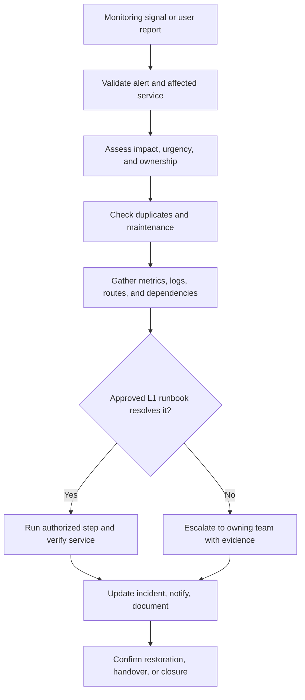

Your work is **not** judged by the number of commands you run. It is judged by timely detection, accurate impact assessment, safe investigation, correct routing, effective communication, and properly documented service restoration.

### 1.3 L1 versus L2 versus L3

- **L1:** Alert acknowledgment, initial investigation, runbooks, preapproved low-risk remediation, ticket handling, shift handover, and escalation.
- **L2:** OS/network/application diagnosis, approved config changes, complex remediation, deeper incident investigation.
- **L3:** Product/code/architecture-level fault isolation, major engineering fixes, vendor escalation, root-cause elimination.

**Boundary:** The real authority is set by company policy, RBAC permissions, the approved runbook, and incident command—not the title alone. An L1 may restart a service *only if expressly authorized*. Do not assume an L1 can reboot VMs, edit NSGs, remove disks, change DNS, or promote a database replica.

---

# 2. Our 20-server production environment

## 2.1 Company scenario

A hypothetical retailer, **BlueCart**, runs a customer website and order-processing application. Customers browse products, submit orders, and receive confirmations. Operations workers process emails, exports, and background jobs. The company relies on a pair of database VMs and identity/DNS services.

**One Azure region**, hypothetical region `centralindia`, is used in this training example. A real business must assess availability-zone support, regional failure, backups, geo-recovery, redundancy and recovery objectives. **Two database VMs do not automatically mean successful failover.** Replication, orchestration, data integrity, and documented promotion steps are required.

## 2.2 Exact VM inventory (20 VMs)

| Group | VM names | Count | Hypothetical role | Business risk |
|---|---|---:|---|---|
| Web | `web-01` … `web-04` | 4 | Serve HTTP requests / reverse proxy | Customers may receive errors |
| App/API | `api-01` … `api-08` | 8 | Orders, authentication, business APIs | Transactions may fail |
| Workers | `wrk-01` … `wrk-04` | 4 | Background queue consumers | Work accumulates; delayed emails/orders |
| Data | `db-01`, `db-02` | 2 | Primary DB and read replica/standby | Orders can fail; data-integrity risk |
| Identity/DNS | `id-01`, `id-02` | 2 | Internal directory/name services | Authentication/name resolution can fail |
| **Total** | | **20** | | |

This is an **example of VM-based architecture**, not Microsoft's preferred architecture for every workload. Managed databases, Azure Kubernetes Service, and PaaS services may replace some VM functions in actual production systems.

## 2.3 Azure network layout

**Training CIDR:** `10.20.0.0/16` (a private VNet address range).

| Subnet | Example CIDR | Hosts/resources |
|---|---|---|
| Gateway subnet | `10.20.0.0/24` | Application Gateway (managed service, **not** one of 20 VMs) |
| Web subnet | `10.20.1.0/24` | 4 web VMs |
| API subnet | `10.20.2.0/24` | 8 API VMs |
| Worker subnet | `10.20.3.0/24` | 4 worker VMs |
| Data subnet | `10.20.4.0/24` | 2 database VMs |
| Identity subnet | `10.20.5.0/24` | 2 directory/DNS VMs |

A `/24` is used for each subnet **for learning convenience**; this is not an optimal real-world subnet-sizing recommendation. The diagram omits dedicated operational subnets, such as `AzureBastionSubnet`, and required supporting network details.

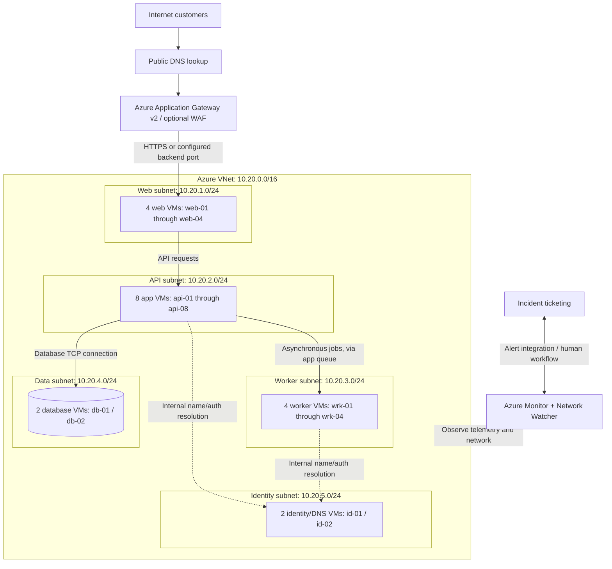

**Important:** In the drawing the gateway is visually outside the VNet block for readability, but a real Application Gateway is **deployed into a dedicated subnet inside the VNet**. An Azure Application Gateway is a managed Layer 7 load balancer; it is not a VM you manually administer.

## 2.4 An ordinary purchase: critical dependencies

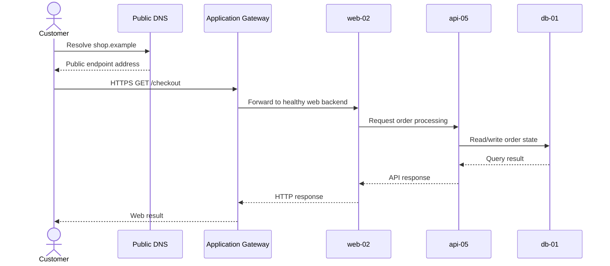

The customer only sees “checkout failed.” Your job is to locate the failed dependency. It could be DNS, gateway, NSG, route, web, API, database, identity, storage or code. **The last visible failure is not necessarily the root cause.**

## 2.5 Think in failure domains

- **One VM fails:** Redundancy may absorb it if health probing and backend selection work.
- **One subnet misconfigured:** All machines in that subnet may lose connectivity.
- **A common dependency fails:** Multiple services fail simultaneously even when all VMs report `running`.
- **Database primary fails:** Recovery depends on replication mode, availability, failover mechanism and correctness.
- **One region suffers a platform event:** More than one resource/service may be affected; Service Health becomes important.
- **Monitor agent fails:** Telemetry disappears even if the app is still serving requests.

A green VM power status is **not** proof that the business application works.

---

# 3. Computer, OS, VM, cloud: what is actually running?

## 3.1 Physical to virtual

**Physical host** = real hardware with CPU, RAM, disk controllers and network interfaces in a data center. **Hypervisor** = virtualization layer that enables multiple isolated virtual machines. **VM** = virtual computer with allocated vCPUs, RAM, virtual disks, a NIC and an operating system. In Azure, Microsoft operates the physical hosting platform, while the customer generally manages the guest OS and applications running inside IaaS VMs.

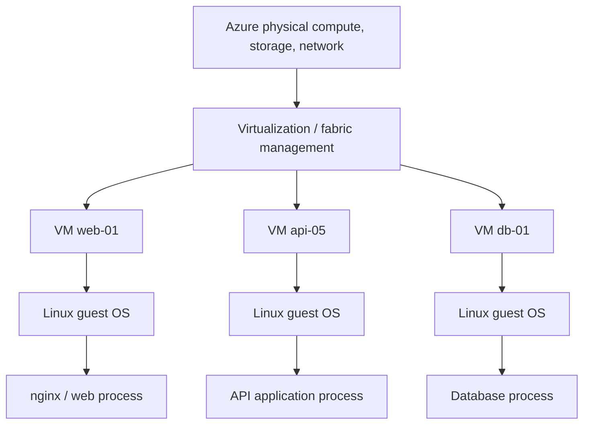

## 3.2 VM states are different from application states

| Concept | What it tells you | What it does NOT prove |
|---|---|---|
| VM power state | Whether Azure sees the VM as running/stopped/deallocated | HTTP app is responding |
| Azure Resource Health | Whether Azure knows of resource-level platform availability issues | Every user request is successful |
| Guest heartbeat | Whether monitoring agent data recently reached its destination | Database queries are correct |
| Process listening | Program bound to a port | Business transaction works end to end |
| HTTP `/health` response | Probe receives expected response | Every feature, data write, or dependent system works |
| Customer synthetic test | A scripted user journey succeeds from probe location | Every user and region has the same experience |

## 3.3 Core OS terms you must understand

**Process:** Running program with a process ID, memory, execution state and OS resources. `nginx` can exist as a process while returning HTTP 502 because its upstream API is failing.

**Service:** Managed long-running program, often controlled by `systemd` on modern Linux. `systemctl status nginx` can report running while the application's response is broken.

**CPU utilization:** Percentage of available compute time consumed. Sustained high usage is worth investigating, but 95% CPU alone does not mean service down. Check response latency, demand trends, throttling and load.

**Memory:** RAM used by applications and the OS. Distinguish used memory, available memory, cache and swap. `free -h` displays `available`; don't treat Linux page cache as automatically problematic.

**Disk capacity versus disk performance:** Full filesystem (`df -h`) is different from slow I/O or high latency (`iostat`, when installed). Also distinguish bytes available, inodes (`df -i`), and storage-quota limits.

**Network interface/NIC:** Interface carrying traffic. It has an IP address, route configuration, link state and counters. Azure associates a virtual NIC with VMs; guest OS sees an interface.

**Port:** A TCP or UDP endpoint number used by a process/service. A program may listen on `127.0.0.1:8080` yet be inaccessible from another VM. Compare binding address (`127.0.0.1` vs `0.0.0.0`), host firewall, Azure NSG, routing and service state.

**Kernel and logs:** Kernel handles networking, filesystem, scheduling and devices; `journalctl` and service-specific logs provide evidence of errors. A kernel panic or filesystem mount failure requires urgent escalation under a defined process.

## 3.4 Availability is a chain, not one check

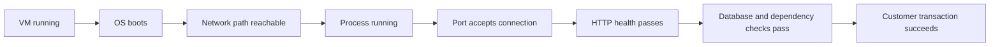

Any arrow can break. A meaningful L1 diagnosis identifies **the furthest confirmed successful stage** and the next failure boundary.

---

# 4. Networking foundations, from packets to applications

## 4.1 Address, protocol, port, path

Before troubleshooting you must answer six questions:

1. **Who is the source?** User browser, a web VM, an API VM, monitoring probe, etc.
2. **Who is the destination?** IP, hostname and specific service.
3. **Which protocol?** ICMP, TCP, UDP, HTTP, TLS, DNS and so forth.
4. **Which port?** E.g., `443` HTTPS, `22` SSH, `3389` RDP, `53` DNS, `5432` PostgreSQL.
5. **Which route?** Subnets, gateways, VPN, user-defined route, firewall, load balancer, internet path.
6. **What is the expected outcome?** TCP handshake, HTTP 200, login success, response within latency target.

### Common port/protocol examples (defaults, not guarantees)

| Port | Transport | Common service | Watch for |
|---:|---|---|---|
| 22 | TCP | SSH | Not exposed publicly unless expressly designed/approved |
| 53 | UDP and TCP | DNS | UDP usual for many queries; TCP needed for other cases |
| 80 | TCP | HTTP | May redirect to HTTPS |
| 443 | TCP / UDP | HTTPS over TCP / HTTP/3 over QUIC (UDP) | HTTP/3 is not a TCP connection |
| 123 | UDP | NTP | Time synchronization dependencies |
| 3389 | TCP / UDP | RDP | Prefer approved secure access |
| 5432 | TCP | PostgreSQL | DB listener, private network only |
| 3306 | TCP | MySQL | DB listener, private network only |

**Key distinction:** A port number does not force a service to be present, and a blocked ping does not prove that TCP/443 is unreachable.

## 4.2 OSI model: seven layers and practical checks

OSI is a **conceptual reference model**, not seven separate software programs. In a cloud network some layers map imperfectly, and troubleshooting should follow observed symptoms.

| OSI layer | Meaning | Common failure | Diagnostic question / tool |
|---|---|---|---|
| **7 Application** | HTTP, DNS application protocol, service semantics | 502, 503, failed login, API 500 | What does `curl -I` show? App logs? |
| **6 Presentation** | Encoding/encryption representation | TLS certificate chain or cipher mismatch | Certificate/handshake error? `openssl s_client` |
| **5 Session** | Session coordination (conceptual) | Session expiry or protocol state problem | Are sessions expiring unexpectedly? |
| **4 Transport** | TCP/UDP ports and transport exchange | TCP timeout/reset, wrong port | Can TCP connect? `nc -vz`, `ss` |
| **3 Network** | IP and routing | Wrong IP, no next hop, NSG routing interaction | `ip route`, Network Watcher Next hop |
| **2 Data Link** | Frames, MAC, local link concepts | Local L2 issue, ARP/neighbour entries | `ip neigh`; cloud overlays limit visibility |
| **1 Physical** | Media/hardware signaling | Link/transceiver failure, fabric outage | On-prem link state; Azure host/platform health |

**Azure-specific caution:** You cannot generally inspect Azure's physical switching fabric as if it were your own rack. For physical/underlay failures use Resource Health, Service Health and Azure Support escalation. Azure NSG is primarily a network/transport policy surface, not a replacement for understanding application failures.

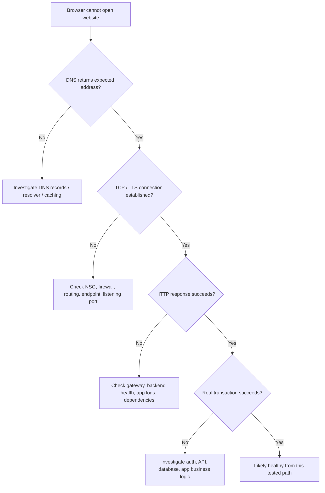

## 4.3 TCP handshake, and what failure types mean

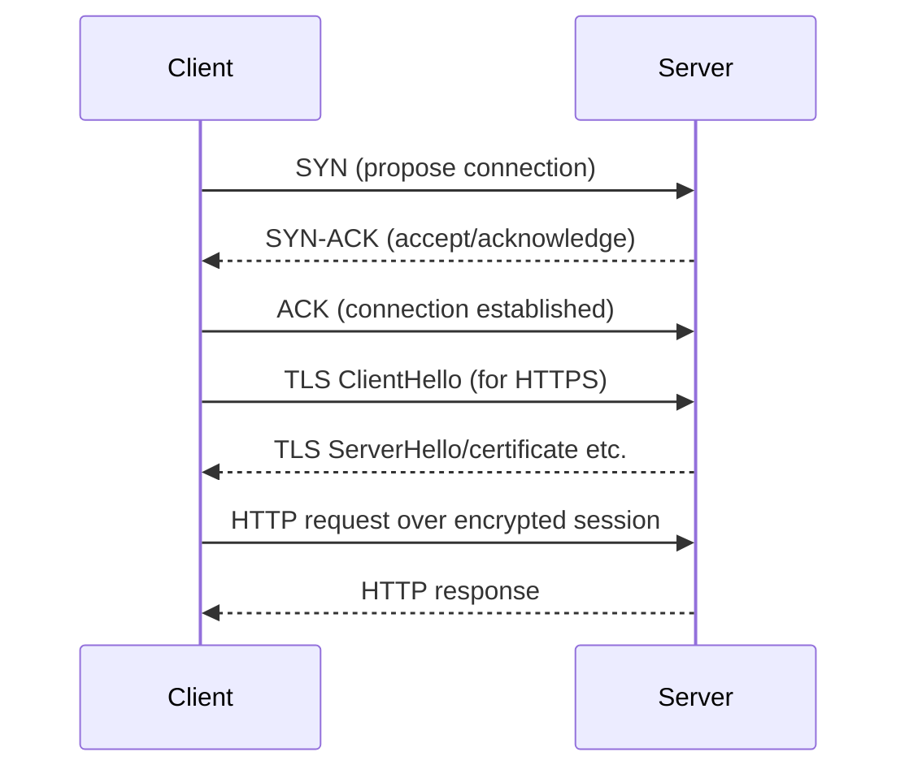

- **Connection timeout:** Might indicate filtering/dropped packets, missing route, unreachable endpoint, or severe congestion; does not by itself identify which.
- **Connection refused / TCP RST:** Endpoint or intermediary actively rejected the connection; often no listener, a reject rule, or a reset by a device. Still investigate exact source.
- **TLS handshake failure:** TCP path may be working, but protocol/certificate/trust/cipher configuration failed.
- **HTTP 502:** Proxy/gateway received an invalid response or failed to communicate successfully with upstream; inspect gateway details and backend.
- **HTTP 503:** Service unavailable / no usable backend / throttling / maintenance are possibilities; read service-specific reason and probe results.
- **HTTP 504:** Gateway/proxy timed out waiting for upstream; possible app/DB slowness or connectivity failure.

**Do not confuse:** TCP `ping` is not a normal tool; standard `ping` uses ICMP. `ping` failure says only that ICMP didn't succeed. Use TCP-specific tests for port-specific connectivity.

## 4.4 CIDR and subnetting (essential)

IP address `10.20.2.15` has 32 bits (IPv4). A prefix `/24` means the first 24 bits describe the network prefix, with 8 bits left for host addressing. Mathematically, a `/24` has `2^8 = 256` total IPv4 addresses. Azure reserves addresses in each subnet; don't equate the raw 256 with assignable VM IPs.

**Example:**

- VNet `10.20.0.0/16` = broad private address range.
- Subnet `10.20.2.0/24` = API range from `10.20.2.0` through `10.20.2.255` as an address block.
- VM `api-05` may have `10.20.2.15` (hypothetical private IP).
- A host in `10.20.1.0/24` reaching this API crosses subnet boundaries at Layer 3, with Azure routing/security behavior applying.

Try this mentally: `10.20.2.15` and `10.20.2.99` are in the same `/24`; `10.20.1.15` and `10.20.2.15` are not. Being in the same VNet doesn't mean NSG/firewall rules automatically permit every flow.

## 4.5 DNS resolution is not TCP connectivity

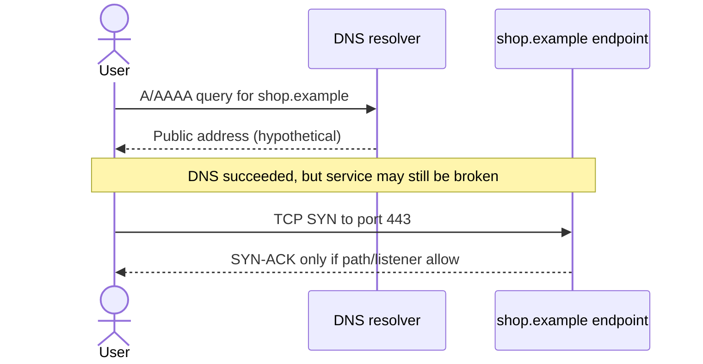

**Useful checks:** `nslookup`, `dig`, `resolvectl status` where available, then `curl`/TCP connection checks. A DNS answer may be stale, point to the wrong endpoint, or return only one of several addresses. A DNS failure may be localized to one resolver/client.

## 4.6 Network troubleshooting is directional

Always specify the **five-tuple** when investigating filtering:

`source IP + source port + destination IP + destination port + protocol`.

For return traffic, the source/destination values reverse. NSGs are stateful: established allowed flows may permit response traffic without a separate reverse-flow rule for every packet. But routes, host firewalls and other devices still matter.

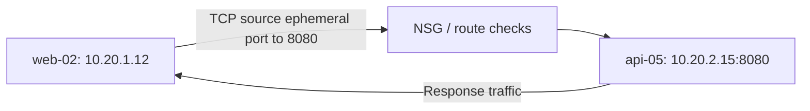

## 4.7 Latency, packet loss, bandwidth, throughput

- **Latency:** Time for a request/packet to reach a destination or round trip. Investigate p50/p95/p99 for apps; averages can hide spikes.
- **Packet loss:** Packets missing in observed path/test. Not every ping loss implies customer-facing TCP loss; ICMP can be rate-limited.
- **Bandwidth:** The link or service's data carrying capacity.
- **Throughput:** Actual data successfully transferred per unit time.
- **Jitter:** Variation in latency, important for real-time voice/video and some network services.
- **Connection count / saturation:** Exhausted connection pools, load-balancer limits, ephemeral ports or service queues can cause failure even with modest CPU.

## 4.8 Network and application timeouts

A browser request can time out because DNS is slow, TCP connections don't establish, TLS fails, a proxy cannot reach a backend, or a database query stalls. Record **where** the timeout is observed, **how long**, and whether retries succeed. Never infer root cause solely from a timeout string.

---

# 5. Azure resource organization and identity

## 5.1 Tenant → subscription → resource group → resource

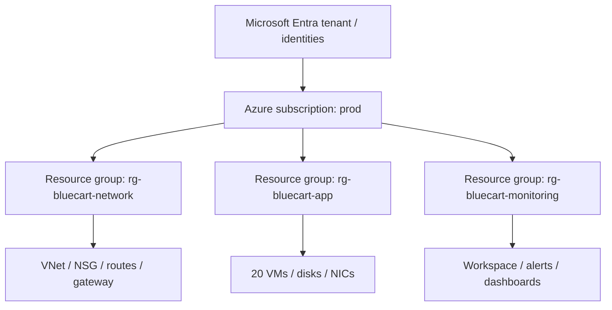

**Tenant:** Identity and organizational boundary via Microsoft Entra ID. **Subscription:** Billing/access/management container for Azure resources. **Resource group:** Logical management container. **Resource:** An individual Azure-managed object, such as VM, NIC, NSG, load balancer, workspace or alert rule. **Region:** Geographic location for regional resources. **Availability zone:** Physically separated datacenter grouping within supported regions. **Tag:** Metadata like `environment=prod`, `owner=payments`, `criticality=high` useful for filtering and ownership.

A VM typically has separate resources associated with it: NIC(s), managed disk(s), configuration and monitoring components. A missing disk or misconfigured NIC can break a VM even when the VM resource exists.

## 5.2 Control plane versus data plane

- **Control plane:** Azure Resource Manager operations such as list VMs, resize a VM, change NSG rule, view Resource Health or configure alerts.
- **Data plane:** Actual app/API traffic, data reads/writes, database transactions and resource-specific service access.

An Azure portal permission to *see* a VM does not imply OS credentials to enter it. Likewise, guest SSH access does not automatically allow changing Azure NSGs.

## 5.3 Identity and least privilege

**Microsoft Entra ID** handles user identity/authentication and many access workflows. **Azure RBAC** determines resource management actions at a particular scope (management group, subscription, resource group, resource). Built-in `Reader` generally reads control-plane resource configuration, but does not automatically guarantee access to every log/data-plane operation. `Monitoring Reader` can access monitoring data under its scope, subject to resource/log permissions and policy. Companies commonly combine roles or custom roles.

**Principle:** L1 staff should be granted only the permissions needed for monitoring/incident response. Production changes should be approved and audited. MFA and company-approved privileged-access processes are standard practices.

## 5.4 Azure Activity Log is not the Linux system log

- **Azure Activity Log:** Management/control-plane operations and Azure platform events, such as VM start or NSG updates.
- **Guest Linux journal/syslog:** Application and OS events *inside* the VM.
- **Azure Monitor resource metrics:** Time-series signals about Azure resources.
- **Application logs/traces:** What the app did for requests and errors.

Example: An NSG change made in Azure could be visible in Activity Log; an application refusing a TCP connection might be visible only in guest-level telemetry or application logs.

---

# 6. Azure networking tools and concepts

These services are often used together; understand **what each one controls**. Names alone aren't enough.

## 6.1 Concept and failure table

| Azure resource/tool | What it does | What to inspect as L1 | Common misconception |
|---|---|---|---|
| **Virtual Network (VNet)** | Private software-defined network address space | VNet/subnet ranges, connection design | VNet does not automatically expose resources publicly |
| **Subnet** | Subdivision of VNet IP space | Does target VM belong to expected subnet? | Subnets aren't always separate physical switches |
| **Network Interface (NIC)** | Connects VM to network with IP configuration | Private IP, attached NSG, effective routes | VM power-on doesn't prove NIC path healthy |
| **Public IP** | Publicly routable endpoint address for a supported frontend/resource | Correct endpoint and association | Every VM does not need a public IP |
| **NSG** | Stateful allow/deny rules on subnet/NIC | Effective rules; direction, priority, source, destination, port | Rule creation is not an appropriate first troubleshooting action |
| **Route table / UDR** | Controls next hop for eligible destination prefixes | Effective routes; expected next hop | Routing and firewall policy are different concerns |
| **Azure Firewall** | Managed, centralized network firewall service | Policy, logs, allowed flows, route through firewall | Not the same as NSG or guest OS firewall |
| **Load Balancer** | Layer 4 flow distribution to backends | Probe status, frontend, backend pool, rule | A live frontend doesn't ensure healthy backend |
| **Application Gateway v2** | Layer 7 HTTP(S) routing, optional WAF | Listeners, probes, backend health, gateway errors | Not the same as L4 Azure Load Balancer |
| **VPN Gateway** | Connects sites/networks over IPsec or other supported VPN scenarios | Tunnel status, BGP/routing where configured | VPN tunnel-up doesn't prove applications work |
| **VNet peering** | Private connectivity between VNets | Peering status, routes, overlapping address ranges | Peering alone doesn't bypass NSG/security policy |
| **Azure Bastion** | Managed protected VM SSH/RDP access | Whether approved access path is available | Doesn't mean VM needs an external public IP |
| **Private Endpoint** | Private IP-based access to certain managed Azure services | DNS target, private endpoint state, routes | Doesn't itself force client DNS to use private answer |
| **Azure DNS / Private DNS** | DNS zones/name resolution services | Records, conditional forwarding, resolution | DNS resolving is not a successful TCP connection |
| **Network Watcher** | Diagnostic and monitoring suite for network | IP flow verify, Next hop, Connection Monitor | Does not replace guest/application monitoring |

### 6.2 NSG rules: concrete example

Hypothesis: `web-02` (10.20.1.12) must reach `api-05` (10.20.2.15) over TCP/8080.

| Policy field | Sample value |
|---|---|
| Direction | Inbound to API destination (plus relevant outbound policies) |
| Protocol | TCP |
| Source | `10.20.1.0/24` |
| Destination | `10.20.2.0/24` or a narrower target |
| Destination port | `8080` |
| Action | Allow (if explicitly approved by architecture) |
| Rule priority | Smaller number is evaluated before larger number among matching user rules |

**How NSG rules work:** An NSG attached at the subnet and/or NIC determines the effective policy. For a new flow, relevant inbound/outbound evaluations must permit traffic. Other firewalls, route tables and applications may still reject it. Azure NSG is **stateful** for established flows.

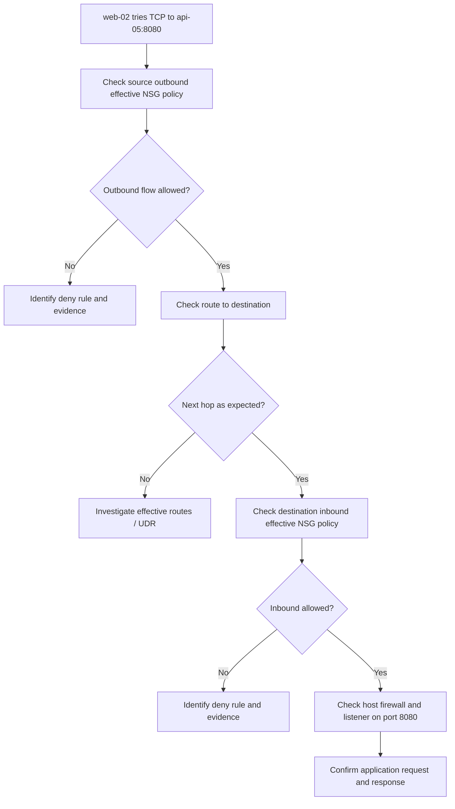

Never “fix” a port issue by globally allowing `0.0.0.0/0` to production SSH, RDP, DB or app ports. Escalate a controlled, scoped rule change request instead.

### 6.3 Network Watcher: the tools you should know best

| Tool | Question it answers | Example |
|---|---|---|
| **IP flow verify** | Would defined traffic to/from a VM be allowed or denied under evaluated policy? | Is web-to-API TCP/8080 blocked by a network rule? |
| **NSG diagnostics** | Which rule allows/denies a simulated flow? | Which NSG rule affects traffic to an application endpoint? |
| **Effective security rules** | What combined security rules apply to this NIC? | Does subnet NSG conflict with NIC NSG? |
| **Next hop** | Where will a packet to this destination be routed? | Is traffic headed to firewall or unexpectedly to `None`? |
| **Effective routes** | What resulting routes apply to this NIC? | Did a UDR override the expected system route? |
| **Connection troubleshoot** | Can a specified source reach an endpoint and what diagnostics are available? | Can app VM reach database TCP/5432? |
| **Connection Monitor** | How is ongoing connectivity between endpoints behaving? | Does private network path show rising round-trip latency? |
| **Packet capture** | What packets actually traverse the observed VM network path? | Is SYN arriving without successful reply? |
| **VPN troubleshoot** | What is the state of a site-to-site VPN connection? | Is corporate data-center connectivity broken? |
| **VNet flow logs** | What IP flows are recorded in the virtual network? | Did the API connection attempt appear? |

**2026 note:** Do not use old tutorials as if creating new **NSG flow logs** were standard: Azure disallowed creating new NSG flow logs after June 30, 2025 and says they retire September 30, 2027. Prefer **VNet flow logs** for new design where supported. See Microsoft links in Chapter 17.

### 6.4 App Gateway versus Azure Load Balancer

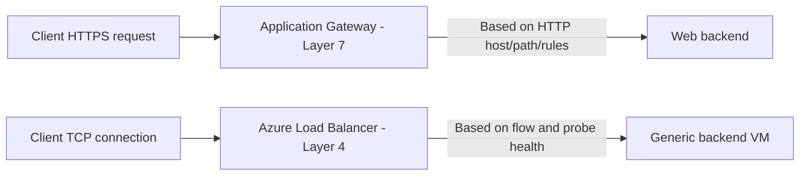

- **Application Gateway:** Understand hostnames, paths, HTTP status codes, listeners, certificates, backend health, WAF effects (when deployed), and HTTP-specific routing.
- **Azure Load Balancer:** Understand frontend IP, backend pool, port mapping, inbound/outbound rules and health probes. It isn't inspecting the full application protocol like an L7 web gateway.
- **Probe failure does not always mean VM stopped**: A health endpoint may return an unexpected status or fail due to routing/configuration/dependency issues.

### 6.5 Azure Bastion and secure operational access

Azure Bastion can provide SSH/RDP through managed connections while VMs retain private IPs. For L1: know **why production VMs should not be given public IPs solely for administration**, and how access approval, identity, logs and RBAC work. You cannot assume every subscription has Bastion deployed.

### 6.6 Networking failure matrix

| Observation | Likely diagnostic direction | Better next check |
|---|---|---|
| DNS returns NXDOMAIN | Bad/missing DNS record or resolution path | Query configured resolver and expected records |
| DNS correct, TCP timeout | Drop, unreachable route, firewall, broken endpoint | IP flow verify, route, TCP probe |
| TCP refused | No listener or active reject | `ss -lntp`, service logs, host firewall |
| TLS error | Cert/trust/protocol/SNI misconfiguration | Certificate dates, chain, SNI, TLS logs |
| TCP works but 502 | Reverse proxy cannot get valid upstream response | Backend health, gateway/application logs |
| Only one backend unhealthy | Host/app/probe-local issue | Compare healthy and unhealthy VMs |
| Every API node unreachable | Shared NSG, route, gateway or dependency | Correlate simultaneous failures and recent changes |
| VPN tunnel down | Remote/hybrid connectivity issue | VPN gateway monitoring, peer, BGP if applicable |
| Intermittent failures | Saturation, retry, DNS, backend distribution | Trend, correlation, connection errors, percentiles |

---

# 7. Azure monitoring, telemetry, and alert architecture

## 7.1 What is observability?

Observability means using outputs of a system to reason about its internal state. Three foundational signal categories are:

1. **Metrics:** Numeric time-series measurements (e.g., CPU 91%, disk used 88%, requests/sec, response p95 latency). Good for trends and thresholds.
2. **Logs:** Timestamped events with context (e.g., `database connection pool exhausted`, NSG update, 502 log). Good for explanations and sequences.
3. **Traces:** Records of an end-to-end request flowing through components, showing which span/step is slow or fails. Good for causality across services.

A fourth useful category is **events/changes** such as VM restart, deployment, alert fired, resource-health transition or NSG update.

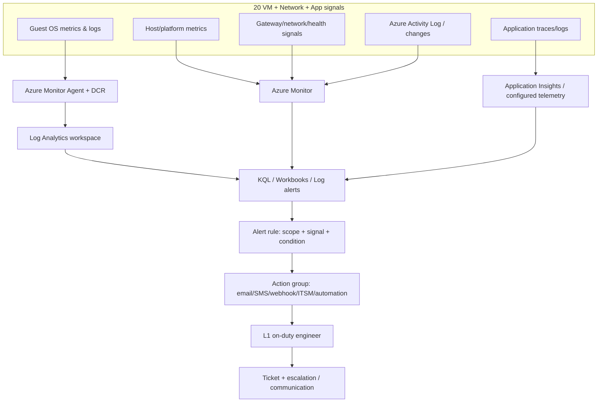

**Architecture note:** This is a *conceptual* data flow. Some logs go directly to a workspace and others via diagnostic settings; App Insights and Azure Monitor Logs are related services, not necessarily separate storage silos. Data collection must be configured appropriately.

## 7.2 Core Azure monitoring services

| Service/feature | What it is | When you would use it |
|---|---|---|
| **Azure Monitor** | Umbrella platform for metrics, logs, alerting, insights | Start when diagnosing resource performance alerts |
| **Metrics explorer** | Time-series metric visualization | Was CPU high for 2 minutes or 45 minutes? |
| **Log Analytics workspace** | Azure Monitor Logs data store | Search events across your fleet |
| **KQL / Log Analytics** | Query language/interface for logs | Which server last sent a heartbeat? |
| **Azure Monitor Agent (AMA)** | Guest OS telemetry collector | Collect OS/application logs and performance data |
| **Data Collection Rule (DCR)** | Controls data sources, processing, destinations | Why do we see CPU but no memory/process logs? |
| **VM insights** | VM performance and monitoring experience | Compare VM performance across servers |
| **Application Insights** | Application request, performance, exception, dependency telemetry | HTTP 500/slow requests / backend bottlenecks |
| **Azure Monitor alert rules** | Conditions that trigger on metrics/logs/events | Alert on low disk, high latency, unhealthy service |
| **Action groups** | Alert notification and workflow targets | Page team or create incident workflow |
| **Alert processing rules** | Apply actions/suppression under configured conditions | Avoid unnecessary paging during approved maintenance |
| **Workbooks / dashboards** | Saved views combining operational data | Single pane for 20-server operations |
| **Service Health** | Azure service/regional events specific to subscriptions | Suspect provider/platform outage |
| **Resource Health** | Availability status of individual Azure resources | Is a VM affected by Azure-side availability problem? |
| **Network Watcher** | Azure networking diagnostics | Investigate NSG/routing/connectivity |
| **Azure Activity Log** | Azure control-plane activity | Who changed the NSG before incident? |

### 7.3 Platform metrics versus guest metrics

For Azure VMs, **host-level** metrics such as host CPU and disk/network behavior are available by default. **Guest OS** insights (such as guest memory, performance counters, OS logs and some process details) require appropriate collection setup; Azure Monitor Agent plus DCR/VM insights is a common route.

Imagine an interviewer asks: “Where in Azure do you see Linux free memory?”

Better answer: “That is a *guest OS* metric; I would check whether guest telemetry collection/VM insights is configured. I would not assume the Azure VM host metrics page automatically provides every memory counter.”

### 7.4 Monitoring the monitoring system

“No data” may mean:

- VM down;
- agent stopped;
- DCR association wrong;
- agent cannot reach collection endpoint;
- collection delay;
- workspace permissions or query time range wrong;
- telemetry table never configured.

This is why **missing Heartbeat ≠ definitive VM outage**.

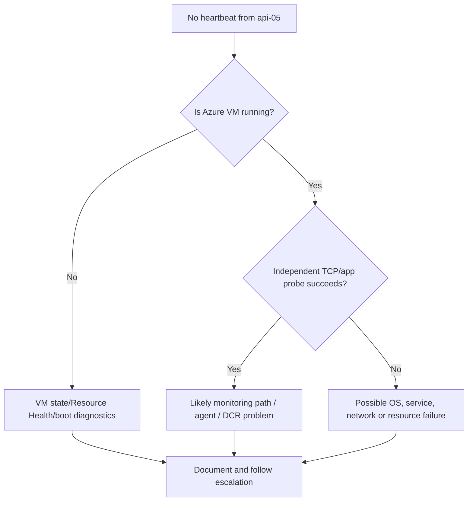

### 7.5 Anatomy of an alert rule

An alert rule includes **scope**, **signal**, **condition**, **evaluation frequency/window**, **severity**, and a **response/action group**. Alerts are not the same as incidents/tickets.

Hypothetical alert:

```text
Name: BLUECART-API-CPU-SUSTAINED
Scope: prod API VMs
Signal: Percentage CPU metric
Condition: average CPU > 90% for the configured evaluation window
Severity: Sev 2 (example; Azure alert severity, NOT ticket priority)
Action: NOC email / ticket integration / on-call routing
Environment: production
Owner: API SRE team
Runbook: RB-API-CPU
```

**State distinctions in Azure Monitor:**

- **Condition** = `Fired` or `Resolved` according to evaluation state.
- **User response** = `New`, `Acknowledged`, or `Closed` as manually managed alert handling state.
- **Ticket status** = ITSM workflow, such as `New → In progress → Resolved → Closed`.

These three are **not equivalent**. Acknowledging an alert does not make the failing service healthy. A resolved metric alert does not automatically prove customer transactions succeeded. Azure metric alerts are stateful by default; configurations can differ.

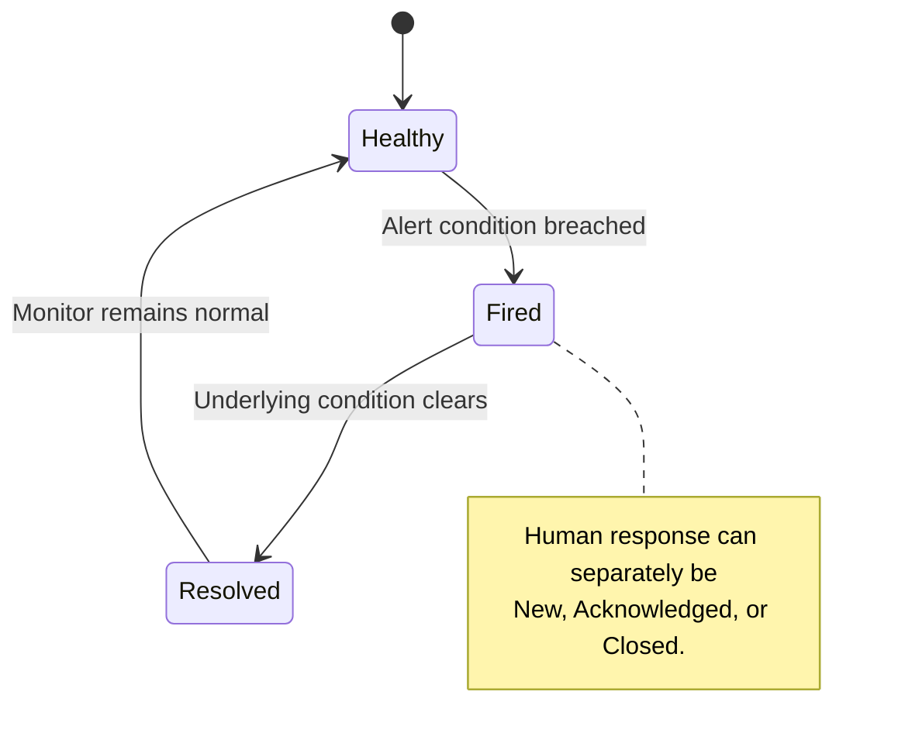

### 7.6 Alerts versus incidents

**Signal:** `CPU 97% on api-05`.  
**Alert:** The monitoring rule was triggered.  
**Incident:** A service disruption/degradation needs tracking and action.  
**Problem:** Underlying cause/pattern requiring long-term elimination, often tracked separately under ITSM.  
**Change:** Controlled modification to production settings/software.  

One incident can be associated with many alerts. Don't create 20 unrelated major incident tickets if one shared network failure is responsible for all 20. Follow the company's event-correlation policy.

### 7.7 Sample alert catalog for our 20-server fleet

These are **illustrative**, not universally recommended thresholds. Production thresholds should be designed from baselines, capacity, service objectives, and the signal's actual semantics.

| Detection | Example trigger | Business meaning | First check |
|---|---|---|---|
| Backend unhealthy | Application Gateway reports backend probe failure | Possible reduced web capacity | Backend pool and probe reason |
| Host CPU elevated | >90% average across configured interval | Performance risk, not automatic outage | Trend, load, application impact |
| Guest memory low | Available memory below internal policy threshold | OOM/swap/latency risk | Guest metrics and process evidence |
| Filesystem capacity high | Filesystem usage >85% (training only) | Write failures may occur | Which volume, growth rate, inode use |
| VM platform unavailable | Resource Health state change | Resource-level availability incident | Platform detail and scope |
| Guest heartbeat missing | No recent AMA heartbeat | Unknown telemetry/VM state | Independent VM and app checks |
| App HTTP errors | Elevated 5xx error ratio | Customers impacted | Top failing backend and time |
| API p95 latency | Above service target | Service performance degradation | Recent deployment, DB/network latency |
| DB replication lag | Above team-defined threshold | Possible failover/data risk | Database monitoring/team runbook |
| VPN disconnected | Tunnel health down | On-prem/Azure connectivity interruption | VPN/remote peer status |
| Azure service incident | Service Health advisory | Wider outage risk | Affected region/services/subscriptions |

### 7.8 Signal correlation matters more than raw alert count

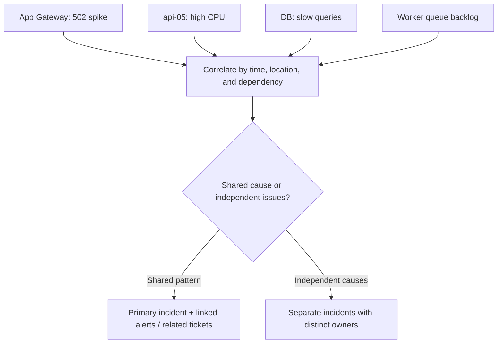

Avoid immediate conclusions. For example, both CPU and 502 errors can be **effects of database slowness**, not separate root causes.

### 7.9 Monitoring has an operational cost

Log Analytics ingestion/retention and some alerting/telemetry features have costs. Azure platform metrics and some activities have different cost behavior. Retention, high-cardinality logs, duplicate DCRs, too-frequent collection and unnecessary flow logs can increase bills. A fresher should recognize the concern but **not disable logging during production incidents to save cost**. Follow observability and governance policies.

---

# 8. What an L1 engineer watches on a normal shift

## 8.1 A useful dashboard for 20 VMs

A practical shift dashboard includes:

1. **Customer availability:** External HTTPS checks, login/checkout journey, error ratio, latency.
2. **Infrastructure:** VM power status, Resource Health, host CPU/disk/network and guest metrics where available.
3. **Networking:** Application Gateway/backend probes, relevant firewall/NSG changes, VPN/Connection Monitor.
4. **Data tier:** DB availability, connections, disk growth, replication alarms (via DB monitoring).
5. **Telemetry freshness:** Last heartbeat, missing metrics/agents, failed ingestion.
6. **Open operational work:** Active incidents, severity, assignee, escalation clock, maintenance windows.
7. **Provider status:** Service Health events that affect deployed region/services.

### Example shift overview (fictional snapshot)

| Group | Available app endpoints | Observed issue | Next action |
|---|---|---|---|
| 4 Web | 3/4 healthy gateway backends | `web-03` probe failed | Validate web-03, check user impact |
| 8 API | 8 VM power states running | `api-05` CPU 94% | Verify p95 and HTTP 5xx before escalation priority |
| 4 Workers | All VMs running | Queue lag rising | Check DB/app dependency and batch load |
| 2 DB | 2 VMs running | Standby replication lag increased | Notify DB owner; don't initiate failover |
| 2 Identity | 2 VMs running | `id-02` AMA heartbeat missing | Independent auth/DNS/VM checks |

**Notice:** “19 of 20 servers healthy” can be misleading if the failed server is a shared dependency. Service health is an end-to-end outcome, not a simplistic percentage.

## 8.2 What does one shift look like?

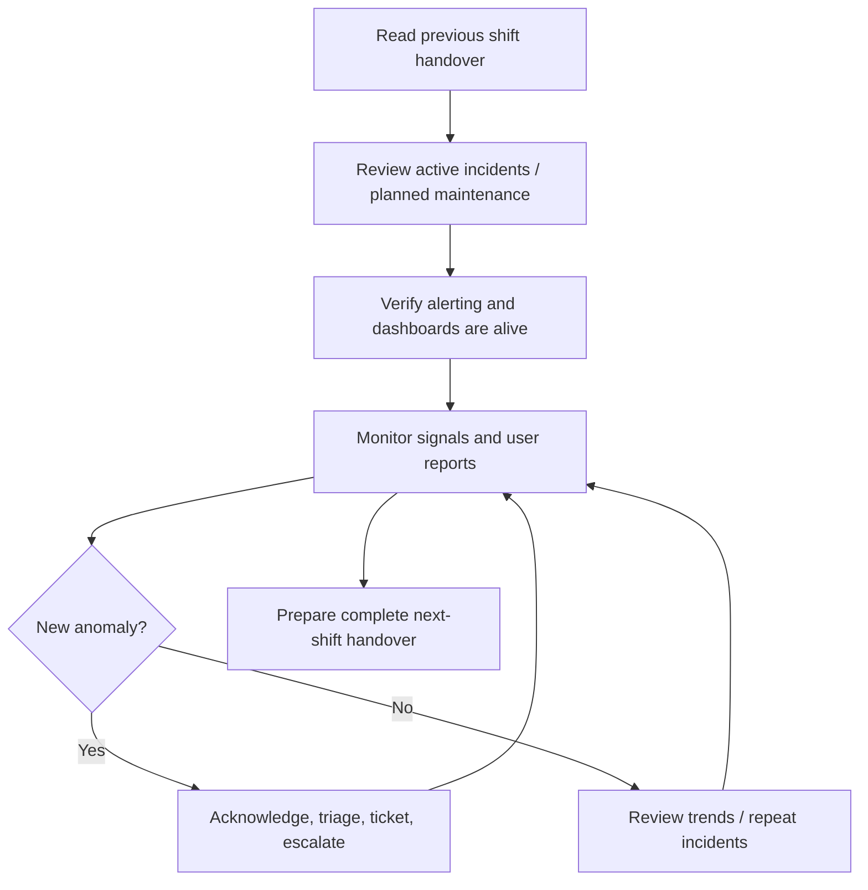

### 8.3 Handover format

```text
Shift: 14:00–22:00 IST (illustrative)
Environment: BlueCart Production / Central India

Critical/High incidents:
- INC-2041: checkout errors, app gateway 502 spike
  Impact: approx. 40% of sampled checkout requests failing (training sample)
  Started: 20:07 IST
  Assigned: App Platform L2
  Last update: 21:43 IST
  Next update: per incident communication schedule

Other issues:
- INC-2038: id-02 monitoring heartbeat stale, auth tests successful
- Change CHG-381: approved maintenance planned for later window

Risks:
- DB disk volume above team-approved warning threshold

Next actions:
- Validate checkout synthetic transaction after L2 fix
- Request DB capacity assessment, keep monitoring growth trend
```

**Time zones matter:** Azure timestamps and logs often display UTC or configured times, while stakeholders operate in local time. Include timezone explicitly and avoid ambiguous “around 2 PM.”

---

# 9. Incident management, severity, SLAs, and escalation

## 9.1 One ticket needs enough information to be actionable

**Minimum incident fields:**

- Ticket ID and short, specific summary.
- Date/time first detected **with timezone**, alert first fired, last known good.
- Subscription, resource group, resource ID/VM name and region (where relevant).
- Environment (`production`, `staging`) and affected business service.
- Symptoms and objective evidence: URLs, IP/ports (where safe), metrics, logs, screenshots/links, error codes.
- Customer/business impact; scope (one node, one subnet, entire service, all users).
- Severity/priority based on **company policy**, not emotion.
- Actions performed and their results (including actions **not** authorized).
- Related changes and existing incident correlations.
- Owner/assignment group and next communication/update time.

### Bad versus useful ticket descriptions

**Bad:** “Server problem. Please fix urgently.”

**Useful:**

```text
INC-2041 — Checkout endpoint intermittently returns 502 in production
Started: 2026-10-17 14:32 IST (09:02 UTC)
Business service: BlueCart Checkout
Scope: Some customer HTTPS requests; 502 ratio ~30% in sample window
Affected component: Application Gateway backend pool / web-03 probe unhealthy
Region: Central India

Verified:
- Public DNS resolves correctly from test endpoint
- HTTPS request reaches application gateway
- Gateway reports web-03 backend health unhealthy
- Other three web backends currently show healthy
- Correlating API and database latency signals under investigation

L1 action:
- Alert acknowledged and incident opened
- No production changes made
- Gateway backend health, logs and time range shared with App L2

Assigned to: App Platform L2; next customer-impact update under SLA
```

All specifics above are **fictional training data**.

## 9.2 Incident priority is not Azure alert severity

A typical organization may use P1–P4 **ticket priorities**. But **there is no universal cross-company P1 table**. Azure Monitor **alert severity** (Sev0…Sev4) is another classification. Don't casually equate the two.

| Sample ticket priority | Illustrative impact | General reaction |
|---|---|---|
| P1 / Critical | Business-critical service completely unavailable or severe widespread disruption | Major incident/urgent escalation per policy |
| P2 / High | Large production degradation or major feature unavailable | Rapid coordination and escalation |
| P3 / Medium | Partial impairment, workaround available | Normal incident handling within agreed target |
| P4 / Low | Low-impact defect, nonurgent operational issue | Queue/work according to SLA |

### Severity, impact, urgency and priority

- **Impact:** How many users/services/revenue-critical processes are affected?
- **Urgency:** How soon will the impact worsen or require response?
- **Priority:** Organization's ordering of response effort, commonly derived from impact + urgency.
- **Alert severity:** Severity metadata of a technical alert rule; useful but not business-impact proof.

If one of 20 VMs disappears but no customers are affected thanks to redundancy, priority may be lower than when the single DB primary is failing. Always apply your employer's severity matrix.

## 9.3 SLA, SLO, SLI, RTO, RPO and incident times

- **SLA (Service Level Agreement):** Contractual service commitments, possibly including availability/response/resolution targets.
- **SLO (Service Level Objective):** Internal/reliability target, such as availability or latency objective.
- **SLI (Service Level Indicator):** Measured service outcome, such as successful checkout ratio.
- **RTO (Recovery Time Objective):** Target maximum service restoration duration for a disaster recovery scenario.
- **RPO (Recovery Point Objective):** Target maximum acceptable data-loss window when recovering data.
- **MTTA:** Mean time to acknowledge/accept an alert/incident (definition may vary).
- **MTTD:** Mean time to detect an incident.
- **MTTR:** Mean time to restore/repair/resolution—**specify which definition your organization uses**.

These are different clocks. Your employer's SLA might measure response from ticket creation, alert firing, or incident start; never assume.

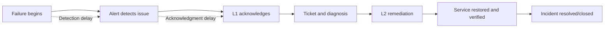

## 9.4 Escalation types

- **Functional escalation:** Route the issue to the responsible specialist: network L2, Azure platform, DB, app, security, or vendor.
- **Hierarchical escalation:** Notify a manager/incident commander because business impact or SLA risk is rising.
- **Major incident declaration:** Organization-specific process coordinating cross-functional response, communications, and recovery.

A good escalation has **clear ask + observed impact + evidence + attempts + owner + required response time**.

## 9.5 Incident lifecycle

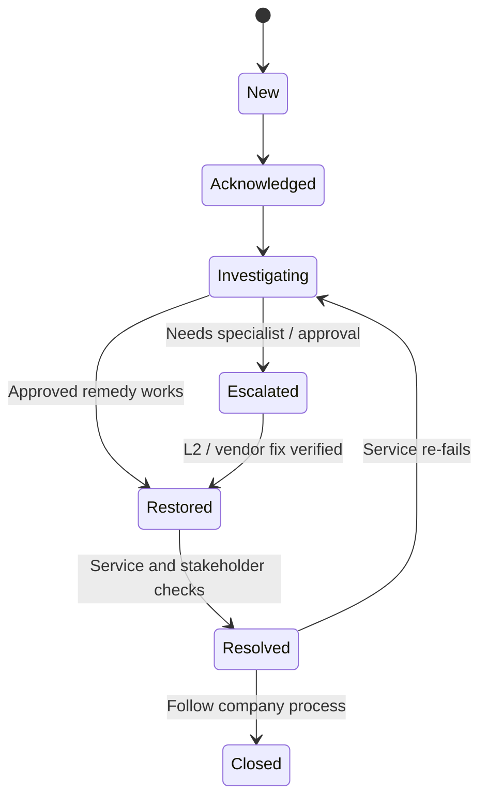

An incident may stay open after technical restoration to capture validation, stakeholder confirmation or follow-up tasks according to company policy.

## 9.6 Safety boundaries and change control

**Generally suitable L1 observations:** Read dashboards, query logs, inspect VM metadata, collect TCP/DNS tests, look at NSG/effective routes and Resource Health, request validation from authorized peers, create/update tickets.

**Normally approval-dependent:** VM reboot, disk deletion, service restart, deployment rollback, NSG/firewall update, DNS record change, route-table update, database failover, disabling monitoring/security controls, widening public access.

**Never assume** a senior engineer's chat message is sufficient permission for every production change. Follow change/incident process, least privilege and audit trail.

---

# 10. Runbooks: actual failure scenarios

The structure for every runbook is **Detect → Validate → Assess impact → Collect evidence → Safe first checks → Escalate/remediate if authorized → Verify → Document**. An L1 should follow the employer's official version when available.

## Runbook A — Production website returns 502 / 503 / 504

**Example alert:** `Gateway 5xx ratio elevated for 5 minutes`.

**First understand:** A 502/503/504 response generated by a gateway/proxy is often about a backend path or availability, but the **exact gateway logs/reason codes** matter. Don't assume database failure just because some customers see 502.

**Investigation:**

1. **Confirm:** Test configured HTTPS URL from an approved monitoring endpoint. Record HTTP code, timestamp, request ID if available, and whether failure is intermittent.
2. **Scope:** Does every URL fail or only `/checkout`? Is impact regional? Did traffic spike?
3. **Gateway:** Check Application Gateway backend health and probe reasons. Compare backend `web-01` through `web-04`.
4. **Layer 4:** If a backend cannot be contacted, check its listener port, NSG and effective routes.
5. **Layer 7:** Check web/proxy logs, API upstream response, application telemetry, recent deployments, DB dependency.
6. **Correlate:** Did gateway/backend changes or app deployment occur immediately before the failure?
7. **Escalate:** Attach gateway health, sample 5xx timestamps, impacted path and dependency evidence to App L2/Network L2 as appropriate. Do not edit gateway backend pools without approval.
8. **Verify:** Run synthetic checkout checks and confirm error ratio returns to baseline, not merely that VMs remain running.

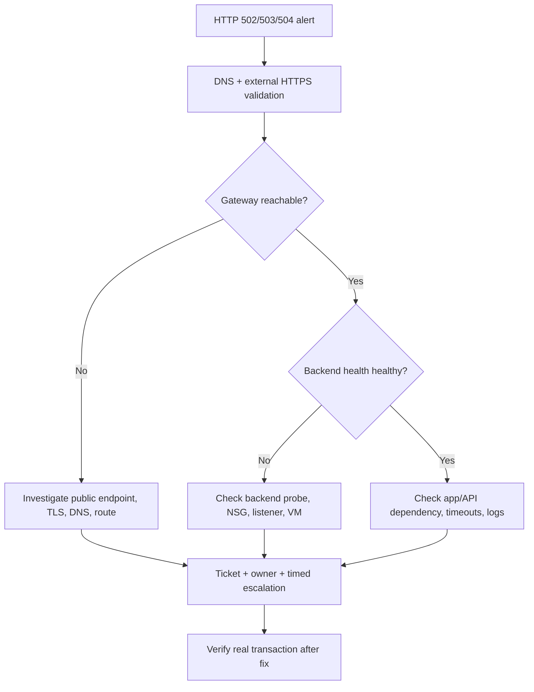

## Runbook B — A single VM stops responding

**Alert:** `web-03 backend unhealthy` / Resource Health unavailable.

1. Check the VM power status **and** Azure Resource Health. A powered-on VM may still have a failed guest OS or service.
2. Compare `web-03` with `web-01`, `web-02`, and `web-04`: same code/deployment? same probe? same subnet/NSG?
3. Check available host CPU, disk metrics, boot diagnostics and guest telemetry. Read guest service logs if authorized.
4. Check for Azure Activity Log actions, planned maintenance and system-level changes.
5. Confirm whether other healthy backends still serve traffic; assess **degraded redundancy** as a risk even without current outage.
6. Record evidence and escalate to VM/OS team or application team. Never reboot as a speculative first step.

**Escalation decision:** One node down and remaining capacity sufficient is different from the only DB writer unavailable.

## Runbook C — Connection blocked between web and API

**Symptom:** `web-02` cannot connect to `api-05:8080`, but API VM appears running.

1. Source `10.20.1.12`, destination `10.20.2.15`, protocol TCP, destination port 8080: write the five-tuple before opening a dashboard.
2. Test target DNS (if hostname is used) and TCP connectivity *from the affected source or representative permitted probe*.
3. Inspect Network Watcher **IP flow verify** and **effective security rules**, including source outbound and destination inbound path where applicable.
4. Inspect **Next hop / effective routes**. Check if a route sends traffic to a firewall or a broken next hop.
5. Check guest service port with `ss -lntp`; inspect guest firewall/SELinux only with appropriate access.
6. Compare the same connection from a healthy web VM. If only `web-02` fails, inspect node-local config; if all web VMs fail, suspect shared path/policy.
7. Correlate Azure Activity Log for relevant NSG/route changes; **do not revert config unless authorized**.

```mermaid
sequenceDiagram
  participant W as web-02
  participant Policy as NSG / routes / firewall
  participant A as api-05
  W->>Policy: TCP SYN to 10.20.2.15:8080
  alt Denied or unroutable
    Policy--xA: SYN fails to reach destination
    Note over W,A: Timeout can result; inspect effective rules/next hop
  else Permitted network path
    Policy->>A: Forward TCP SYN
    alt Listener running
      A-->>W: SYN-ACK and application traffic
    else No listener/reject
      A-->>W: TCP RST or no response depending on failure
    end
  end
```

## Runbook D — DNS fails, IP connectivity may still work

**Symptom:** `api.internal.example` fails to resolve from one or more VMs.

1. Identify precise resolver (`resolvectl status`, `/etc/resolv.conf`, `nslookup`) and record what name/type was requested.
2. Compare one failing VM with a healthy VM, and compare public DNS with internal/private DNS path.
3. Check health of `id-01` and `id-02` if those are authoritative/recursive DNS services; check firewall and DNS TCP/UDP 53 reachability when appropriate.
4. Verify the expected record exists, whether private DNS zones/links/forwarders apply, and recent DNS/config changes.
5. Check whether the affected application caches DNS or has stale connection pools.
6. Escalate to the DNS/network/identity team with resolver address, queried FQDN, return code, TTL, sample result and time.

**Warning:** Pinging a DNS server's IP and seeing a response does **not** prove that its DNS service responds on port 53 or returns the right records.

## Runbook E — CPU 95% on `api-05`

**Symptom:** High average host CPU, but users have not necessarily noticed anything.

1. Check **duration**, shape and baseline: is CPU 95% for 30 seconds or for 40 minutes?
2. Look at **service impact**: API latency p95/p99, 5xx rate, request volume, queue backlog.
3. Compare `api-05` with other API VMs and determine whether workloads are distributed equally.
4. Check whether a deployment, scheduled batch, scan, unexpected traffic or process issue correlates.
5. With authorized OS access, check process usage using `top`, `ps`, `uptime` and app logs (avoid heavy diagnostic commands on a fragile node).
6. Determine whether this is a **capacity event** or an **application defect**, and escalate with evidence.

**Don't:** Restart the VM or kill its highest-CPU process merely because it is consuming resources. That process could be serving real customers.

## Runbook F — Database filesystem nearly full

**Symptom:** `db-01` database volume usage rises toward the team’s critical threshold.

1. Confirm whether this is **filesystem usage**, inode exhaustion, underlying Azure disk capacity, or performance. They are separate problems.
2. Determine exact mount/drive and growth trend. Check `df -h`, `df -i`, and approved disk metrics.
3. Identify whether transaction logs, database files, backups, temp files or other data are growing, without deleting anything.
4. Check whether database writes/queries or replication have been affected.
5. Escalate urgently to DBA/storage/infra owners with space remaining, growth rate and impact. Expansion/cleanup must be approved and compatible with the database.

**Never delete PostgreSQL WAL, MySQL binlogs, database files, or unknown large files to regain disk space.** You risk corrupting data and breaking recovery.

## Runbook G — Missing `Heartbeat`, but Azure says VM running

**Symptom:** `id-02` has not sent AMA heartbeat for 12 minutes.

1. Confirm the query uses the correct Log Analytics workspace, time range and table, and collection should exist for that VM.
2. Compare independent signals: VM power status, Azure platform CPU, synthetic DNS/authentication probe, Resource Health.
3. Check monitoring-agent health, DCR association, ingestion delay and outbound connectivity if authorized.
4. Create a monitoring incident if agent/data collection is broken; escalate a customer-facing outage only if independent evidence supports it.
5. Document whether the visibility gap affects required monitoring coverage.

**Lesson:** A monitoring gap is itself an operational concern, but it is not automatically proof that server or application went offline.

## Runbook H — 20 servers alert simultaneously

**Symptom:** CPU, heartbeat or network-connectivity alarms fire on almost all VMs within two minutes.

1. **Check whether all alerts share a common source**: same monitoring workspace, DCR, route, firewall, DNS or region.
2. Check external synthetic probes. Is the business service actually unavailable?
3. Check **Azure Service Health**, then representative Resource Health statuses.
4. Check recent infrastructure changes: UDR/NSG/firewall rules, DNS servers, monitoring agent rollout, workspace access, routing/VPN.
5. Compare signals from another region or independent source, if available.
6. Correlate into an incident or major incident per company policy. Don't open 20 completely independent tickets without considering common cause.
7. Escalate to incident commander/platform/network team with a scope matrix and timeline.

```mermaid
flowchart TD
  A[20 alarms within 2 minutes] --> B{Customer synthetic probe fails?}
  B -->|No| C[Monitoring pipeline / DCR / workspace / false alarm investigation]
  B -->|Yes| D[Service outage investigation]
  D --> E{Azure Service Health relevant incident?}
  E -->|Yes| F[Provider event plus local service mitigation assessment]
  E -->|No| G[Shared network / DNS / database / app dependencies]
  C --> H[Correlate, ticket, escalate as appropriate]
  F --> H
  G --> H
```

## Runbook I — Planned maintenance versus real outage

- Check approved change calendar and exact affected resources, scheduled window and expected symptoms.
- Do not suppress alerts indefinitely or assume every failure inside the window is harmless.
- Azure **alert processing rules** can intentionally suppress notifications; the underlying signals may still exist.
- If symptoms exceed planned scope/window, report a new incident, contact the change owner and follow rollback/escalation procedure.
- Record time zone and change reference.

## Runbook J — Suspected security problem

If you observe brute-force attempts, unauthorized access, suspicious flows or data exposure: preserve relevant evidence, follow security incident reporting and involve SOC/security immediately as policy dictates. Avoid changing firewall/security controls without the incident response team's direction, especially when it may erase evidence.

## 10.1 L1 evidence checklist for any incident

```text
[ ] Alert ID/rule, first fired time (timezone)
[ ] Service name and business impact
[ ] Known-good time and last failed test
[ ] VM/Resource IDs and affected scope
[ ] Alert condition vs acknowledgment vs ticket state
[ ] Relevant metrics/trend screenshots/links
[ ] Error code and actual observed command/test result
[ ] DNS/IP, TCP port, application protocol where relevant
[ ] NSG/routing/backend health evidence if networking
[ ] Azure Activity Log / deployment/change history
[ ] Azure Resource Health and Service Health checked
[ ] Duplicate incidents/maintenance checked
[ ] Authorized L1 actions only; results documented
[ ] Assignment group and next update time
[ ] Recovery independently validated
```

---

# 11. Linux, Windows, and Azure read-only command reference

> **No Azure account required to study syntax.** These are examples you can understand on paper. Some commands need local tools, login, role permissions, or sudo; don't run them on production without authorization. Prefer passive and bounded diagnostic checks.

## 11.1 Linux: generic monitoring and diagnosis

```bash
# OS version: Ubuntu / AlmaLinux / RHEL / CentOS
cat /etc/os-release

# Uptime and system load
uptime

# CPU/memory status
free -h
top -b -n 1 | head -n 20

# Disks: capacity and inodes
df -h
df -i
lsblk -f

# Network interface and routes
ip -br addr
ip route
ip neigh

# DNS: tool may require package installation
getent hosts example.com
nslookup example.com

# TCP connectivity to an endpoint
nc -vz -w 3 10.20.2.15 8080

# HTTP/HTTPS endpoint headers and response details
curl -Iv --connect-timeout 5 https://example.com

# Listening TCP/UDP sockets with process names (privileged detail varies)
sudo ss -tulpn

# Service status and recent logs
systemctl status nginx
journalctl -u nginx -n 50 --no-pager

# Network/filtering config (distro-specific)
sudo firewall-cmd --list-all  # firewalld often on AlmaLinux/RHEL
sudo ufw status               # UFW where configured on Ubuntu

# SELinux mode where SELinux tools/configuration are present
getenforce
```

**Interpretation tips:**

- `uptime` shows load average, not directly “CPU%.”
- `free -h` has `available` memory; do not panic over page cache alone.
- `df -h` gives filesystem capacity; not disk latency.
- `ss -tulpn` shows local listening sockets; it does not prove Azure network paths permit remote traffic.
- `curl -I` sends a HEAD request; some services do not support HEAD properly, so use an approved GET-based health endpoint when appropriate.
- `nc -vz` only checks a TCP connection attempt, not complete application correctness.
- `systemctl status` is evidence of service supervisor state, not proof that every transaction succeeds.

## 11.2 Common HTTP evidence you should recognize

```bash
curl -sS -o /dev/null \
  -w 'http=%{http_code} dns=%{time_namelookup}s tcp=%{time_connect}s tls=%{time_appconnect}s total=%{time_total}s\n' \
  --connect-timeout 5 --max-time 12 \
  https://example.com/health
```

This can separate observed DNS, TCP, TLS and total timing. Timings are from the current test location and do not isolate every backend dependency. Run only against endpoints you are authorized to test.

## 11.3 Windows Server basics (PowerShell)

```powershell
# Network configuration
Get-NetIPConfiguration

# DNS lookup
Resolve-DnsName example.com

# TCP connectivity
Test-NetConnection 10.20.2.15 -Port 8080

# Routing
Get-NetRoute

# Service status
Get-Service

# Recent System events
Get-WinEvent -LogName System -MaxEvents 20

# Running processes (sample)
Get-Process | Sort-Object CPU -Descending | Select-Object -First 10
```

For Windows, also know **Event Viewer**, Services, Task Manager, Resource Monitor, and RDP access policy.

## 11.4 Azure CLI — orientation and read-only queries

These commands require the Azure CLI and access to the right Azure subscription. **They are reference commands; you cannot execute them successfully without an account and appropriate permissions.**

```bash
# Authenticate through your organization's approved process
az login

# Show selected account/subscription
az account show --output table

# List resource groups
az group list --output table

# Show VM inventory and power state
az vm list -d --output table

# Show one VM instance status (example placeholders)
az vm get-instance-view \
  --resource-group rg-bluecart-app \
  --name api-05 --output json

# Get the VM's configured NIC references and metadata
az vm show \
  -g rg-bluecart-app -n api-05 --output json

# List NSGs and route tables
az network nsg list --output table
az network route-table list --output table

# List metric alert *rules*, not current alert instances
az monitor metrics alert list --output table

# Query subscription activity (results vary by scope/permissions)
az monitor activity-log list --max-events 10 --output table
```

**Warning:** `az monitor metrics alert list` lists configured metric alert rules; it does **not** show the set of currently fired instances. Check the portal's **Monitor → Alerts** or the appropriate Alerts Management interface for alert instances. This is a common interview distinction.

Some Azure tools involve permissions, charges or state changes. This handbook intentionally avoids presenting production mutation commands as default L1 actions.

## 11.5 Command → troubleshooting layer mapping

| Tool | Primarily checks | Does NOT establish |
|---|---|---|
| `ip addr` | Local interface/IP | End-to-end traffic success |
| `ip route` | Guest kernel's route selection | Azure UDR/NSG/physical path correctness |
| `nslookup` | DNS server answer | Application available |
| `ping` | ICMP responses where permitted | TCP port/application reachable |
| `nc -vz` | TCP connection attempt | HTTP/auth/business operation succeeds |
| `curl -Iv` | TLS/HTTP response for tested endpoint | Every backend/user path is healthy |
| `ss -lntp` | Local listener state | Host firewall or NSG allows remote traffic |
| `systemctl status` | OS service manager state | User experience correct |
| Network Watcher IP flow verify | Evaluated network-rule decision | OS process functioning |
| Resource Health | Platform's resource-specific assessment | Guest application health |
| Service Health | Relevant Azure service-wide event | A specific app is broken for that reason |

---

# 12. KQL: querying logs without an Azure account

**Kusto Query Language (KQL)** is the query language used to analyze logs in Azure Monitor / Log Analytics. It is especially useful when 20 VMs produce more data than you can inspect one at a time. You can learn its syntax before getting Azure access.

## 12.1 Mental model

Think of a log table as rows of events:

| TimeGenerated | Computer | CounterName | CounterValue |
|---|---|---|---:|
| 10:00:00 | api-05 | CPU | 93 |
| 10:00:00 | api-06 | CPU | 42 |
| 10:01:00 | api-05 | CPU | 96 |
| 10:01:00 | api-06 | CPU | 39 |

KQL reads a table and pipes each result through transformations:

```kusto
SomeTable
| where TimeGenerated > ago(1h)
| where Computer == "api-05"
| summarize AvgValue = avg(CounterValue) by Computer
| order by AvgValue desc
```

**Operators to master:** `where` (filter rows), `project` (select columns), `summarize` (aggregate), `count`, `avg`, `max`, `min`, `arg_max` (last row by timestamp), `sort by` / `order by`, `take`, `extend` (new calculated column), `join` (correlate tables), `bin` (group by time interval).

## 12.2 Last heartbeat from every reporting VM

> `Heartbeat` exists only when the necessary telemetry collection is configured and data is flowing to that workspace. A machine never configured to report won't appear just because it exists in your inventory.

```kusto
Heartbeat
| where TimeGenerated > ago(24h)
| summarize LastSeen = max(TimeGenerated) by Computer
| order by LastSeen asc
```

**Question answered:** Which *reporting* computers have the oldest recent heartbeat? **Question NOT answered:** Are all configured 20 VMs present? For that you also need an authoritative inventory and a comparison.

## 12.3 Find stale heartbeat among computers seen in last 24 hours

```kusto
Heartbeat
| where TimeGenerated > ago(24h)
| summarize LastSeen = max(TimeGenerated) by Computer
| where LastSeen < ago(10m)
| order by LastSeen asc
```

A result means **no recent heartbeat in the selected workspace**, not necessarily VM power-off. Understand clock skew, ingestion delay, expected data and agent configuration.

## 12.4 Generic VM performance query

```kusto
Perf
| where TimeGenerated > ago(1h)
| summarize AvgValue = avg(CounterValue), MaxValue = max(CounterValue)
    by Computer, ObjectName, CounterName
| order by MaxValue desc
| take 30
```

**Prerequisite:** Relevant performance counters must be collected to the `Perf` table. Counter names and mappings differ across Linux/Windows, agent/DCR configurations, and tables. You must inspect the actual available schema before adapting to a particular CPU or memory counter.

## 12.5 Look at a selected performance counter over time

```kusto
Perf
| where TimeGenerated > ago(2h)
| where Computer == "api-05"
| where CounterName contains "Processor"
| summarize Mean = avg(CounterValue) by bin(TimeGenerated, 5m), CounterName
| order by TimeGenerated asc
```

**Important:** The literal `CounterName contains "Processor"` is only an illustrative filter. It will not match every Linux CPU metric. In production, start with `distinct CounterName` or inspect the workspace schema.

```kusto
Perf
| where TimeGenerated > ago(2h)
| summarize by ObjectName, CounterName
| order by ObjectName asc
```

## 12.6 Management changes (when Activity Log is routed to the workspace)

```kusto
AzureActivity
| where TimeGenerated > ago(2h)
| project TimeGenerated, OperationNameValue,
          ActivityStatusValue, ResourceGroup, ResourceId
| order by TimeGenerated desc
```

**Prerequisite:** `AzureActivity` data must have been routed to the workspace via appropriate diagnostic settings/export. The Azure portal's native Activity Log is available separately; the presence of an Activity Log in Azure does **not** automatically mean it exists in that workspace table.

## 12.7 Learn KQL with simulated data (no subscription)

The `datatable` operator lets you reason from a fictional sample:

```kusto
let Sample = datatable(Computer:string, Role:string, CPU:real, Errors:int)
[
  "web-01", "web", 22.0, 0,
  "web-02", "web", 31.0, 4,
  "api-05", "api", 96.0, 70,
  "api-06", "api", 40.0, 1,
  "db-01", "db", 84.0, 20
];
Sample
| where CPU > 80 or Errors > 10
| project Computer, Role, CPU, Errors
| order by Errors desc
```

Expected output: `api-05` and `db-01` match the filter. But **CPU and Errors alone do not prove root cause**. A downstream database issue can create elevated API errors and CPU as symptoms.

## 12.8 How to think before every query

1. **Which table?** Are data collection and routing configured?
2. **What time window?** Query specific incident time with timezone in mind.
3. **What resource scope?** Workspace may span multiple subscriptions/environments.
4. **What property?** `Computer`, `_ResourceId`, operation name, status code, service name.
5. **What comparison?** Broken node versus healthy node, before versus after deployment.
6. **What does absence mean?** No records may be missing collection, not a healthy system.
7. **What next?** Save/export an evidence link or summary in the ticket.

---

# 13. Complete 20-server outage simulation

Here is a **full fictional incident** to understand seriousness, sequencing and why an operator cannot simply acknowledge an alert and stop there.

## 13.1 Starting point: all 20 VMs running

BlueCart has 4 web VMs, 8 API VMs, 4 workers, 2 DB VMs and 2 identity/DNS VMs. Azure reports that **all 20 VMs are in `running` power state**. The customer website is accepting orders. Application Gateway routes requests to healthy web instances. The primary DB is `db-01` and `db-02` is a standby according to the application's configured database architecture.

At **20:07 IST**, the L1 shift receives several alerts. No one has yet confirmed the root cause.

## 13.2 Timeline and first observations (training sample)

| Time (IST) | Alert/observation | First interpretation |
|---|---|---|
| 20:07 | Checkout HTTP 5xx ratio rises from baseline to 28% | Real customer-impact candidate |
| 20:08 | Application Gateway reports increased backend response failures | Upstream path or application concern |
| 20:09 | `api-05`, `api-06` CPU rising; DB connection-related log errors | Possible shared dependency/pool issue |
| 20:10 | Workers show backlog rising | Secondary effect of failed downstream calls |
| 20:10 | VM power dashboard still shows all 20 running | VM power state does not capture service failure |
| 20:11 | `db-01` reports high active connection count | DB tier may be implicated; not yet proven |
| 20:12 | Team identifies a deployment at 20:03 | Correlation to investigate, not automatic proof |

### Why this situation is serious

Customers may abandon payments or create duplicate retries; the company may lose revenue, accumulate delayed background jobs, and generate more database load through automatic retries. A hasty reboot or indiscriminate database failover might **increase** disruption or jeopardize data consistency.

## 13.3 Your first 5 minutes as L1

**20:07–20:08 — Acknowledge and validate**

- Verify that the monitoring alert is real and which synthetic check is failing.
- Check one authorized checkout request and application error-rate graph; do not perform actual paid purchases unless testing is explicitly designed for it.
- Check for existing major incidents and planned maintenance.

**20:08–20:09 — Assess impact**

- Determine proportion of failed requests, user locations, services affected, and whether the issue is limited to checkout.
- Apply the company priority matrix and page on-call team early if the threshold is met. **Do not wait to fully solve the root cause before escalation.**

**20:09–20:10 — Check dependencies**

- App Gateway error trend/backend health.
- API request rate/latency/error trend.
- DB availability and connection count from approved dashboard.
- Azure Service Health and Resource Health for relevant infrastructure issues.

**20:10–20:12 — Open/assign incident**

- Create a ticket containing tested symptoms, scope and timeline.
- Escalate to App Platform L2 and DB team, attaching monitoring evidence.
- Notify incident coordinator if major incident policy applies.

## 13.4 Root-cause hypothesis tree

```mermaid
flowchart TD
  A[Checkout 5xx + high API errors] --> B{App Gateway backend probes healthy?}
  B -->|No| C[Web backend / probe / network branch]
  B -->|Yes| D[Check API latency, app exceptions, dependency telemetry]
  D --> E{DB connection failures correlate?}
  E -->|No| F[Investigate API application / external dependency]
  E -->|Yes| G[DB health, max connections, pooling, deployment changes]
  G --> H{Recent deployment changed connection behavior?}
  H -->|Possible| I[App L2 + DBA validate, coordinate approved mitigation]
  H -->|No evidence| J[Continue fault isolation; do not claim root cause]
```

## 13.5 Hypothetical eventual outcome

Suppose **App Platform L2** confirms an application deployment inadvertently multiplied database connection pools. The number of concurrent DB sessions increased, some API requests stalled, retries amplified load, and workers accumulated backlog. Under approved change/incident procedures, L2 **rolls back** the faulty application version. DB team checks connection recovery. An L1 **does not independently trigger this rollback**.

This is **one possible scenario**; the original alert set alone would not have established it.

### Verification must be layered

1. Checkout synthetic requests now succeed from relevant test locations.
2. HTTP 5xx ratio falls to baseline and latency meets target.
3. API dependency errors and DB connection counts normalize.
4. Workers catch up and queues no longer grow.
5. No unexpectedly failed, incomplete or duplicate orders are reported (validated by responsible app/business owners).
6. Alerts settle, ticket is updated, and stakeholders get restoration notice.
7. Follow-up problem/RCA items capture long-term fixes: deployment testing, connection limits, rate limiting, observability or release control.

## 13.6 Why L1 needs business context

Two alerts can have the same numeric severity but completely different operational significance:

- One worker stopped, queue still drains within target: **capacity/redundancy concern**.
- Checkout failures for 40% of customers: **direct business impact**.
- Primary DB full: **potential data loss or write failure risk**.
- AMA heartbeat missing from one identity VM while authentication tests succeed: **observability concern, not proven customer outage**.

An experienced operator asks “**What customer or system capability is failing?**” before “Which VM has the highest CPU?”

## 13.7 Major incident communication example

```text
Incident: INC-2041 [Priority determined by company matrix]
Current status: Investigating / escalated
Start time: 20:07 IST
Affected service: Checkout API
Customer impact: Elevated failed checkout requests (see linked monitoring graph)
Observations: Gateway 5xx elevated; API errors and DB connections increased
Mitigation: App Platform L2 and DB owners investigating; no L1 production changes
Next update: At incident manager's agreed interval
Evidence: Alert IDs, charts, request errors, recent deployment reference
```

### Seriousness does not justify guessing

An L1 who states “The database is down” without verifying it can send the incident to the wrong team and delay recovery. An L1 who observes **DB-related failures, reports the evidence and escalates immediately** is performing the role correctly.

---

# 14. Fresher interview questions with model answers

Study these as **concept + why it matters + first investigation step**, not memorized one-liners.

## 14.1 Networking (questions 1–14)

1. **What is a computer network?** A set of endpoints communicating over agreed protocols; troubleshooting requires source, destination, addressing, path and application outcome.
2. **What is an IP address?** Logical network address of an interface; public/private IP usage differs by routability and architecture.
3. **What is a subnet?** A defined IP prefix partitioning network addressing and policy/routing boundaries.
4. **What is CIDR `/24`?** 24 network bits in IPv4, leaving 8 host bits; 256 total addresses in the mathematical range, with Azure reservations reducing assignable IPs.
5. **What is a default gateway?** Default next-hop routing choice when no more-specific route applies.
6. **What is DNS?** Name-to-record resolution system, not proof that the destination service is responsive.
7. **What is DHCP?** Service/protocol for automatic host network settings such as IP/gateway/DNS; Azure networking has its own platform-provided addressing behavior.
8. **What is NAT?** Translation of IP addresses and possibly ports along a network path; distinguish outbound internet access from inbound reachability.
9. **What is TCP?** Transport protocol providing reliable ordered byte-stream communication with connection establishment and congestion/flow control.
10. **What is UDP?** Datagram transport without TCP's built-in connection setup or delivery guarantee; applications may implement their own reliability.
11. **What happens during a TCP handshake?** SYN → SYN-ACK → ACK; application protocols such as TLS/HTTP follow when applicable.
12. **Is failed ping proof a server is down?** No; ICMP may be filtered or rate-limited. Test expected protocol/port and alternative signals.
13. **What is packet loss?** Not all packets in the observed path/test are delivered; investigate scope, test method, device behavior and real traffic impact.
14. **How is troubleshooting by OSI layer useful?** It narrows the failing stage: DNS, routing, transport, TLS, HTTP or application dependency, rather than changing random settings.

## 14.2 Azure cloud/networking (questions 15–25)

15. **What is Azure VNet?** Customer-defined isolated virtual network address space hosting connected Azure resources and subnetting.
16. **What is an NSG?** Stateful Azure network filtering rules attached to eligible subnets/NICs, matching traffic properties and priority.
17. **NSG vs firewall?** NSG provides simpler L3/L4 network ACL behavior; Azure Firewall supplies managed centralized firewall and richer policy/logging functions.
18. **What is UDR?** User-defined route overriding/adding routing decisions for selected destination prefixes.
19. **What is Azure Load Balancer?** L4 distribution with frontend/backend, rules and health probes.
20. **What is Application Gateway?** L7 HTTP(S) routing/load-balancing solution with listeners, backend health, optional WAF and other web-centric features.
21. **What is Network Watcher?** Azure tools for diagnosing filtering, next hops, routes, connectivity, packet flows and VPN issues.
22. **IP flow verify vs Next hop?** IP flow verify assesses a packet-flow policy decision; Next hop shows where destination traffic is routed.
23. **What is Azure Bastion?** Managed SSH/RDP access to private-IP VMs without assigning public IPs to those VMs.
24. **Service Health vs Resource Health?** Service Health reports relevant Azure service/regional incidents; Resource Health gives resource-specific availability assessment.
25. **What is Azure RBAC?** Azure authorization assigning roles at scopes; portal access doesn't automatically grant OS login or unrestricted production changes.

## 14.3 Monitoring and operations (questions 26–39)

26. **Metric vs log vs trace?** Numeric trend; event/context; end-to-end request path respectively.
27. **What is Azure Monitor?** Azure telemetry, analysis and alerting platform for cloud/hybrid resources and applications.
28. **What is Log Analytics?** Workspace-backed log query experience, commonly using KQL.
29. **What is the Azure Monitor Agent?** VM guest monitoring collector whose collection is directed/configured using DCRs.
30. **What is a DCR?** Rule defining specified telemetry sources, processing and destinations for supported collection paths.
31. **What is an alert rule?** Monitored scope + signal + threshold/condition + evaluation and action behavior.
32. **What is an action group?** Set of alert notification or automation targets (email, webhooks, integration, etc.).
33. **Does missing Heartbeat mean VM down?** No; could be agent/DCR/network/ingestion problem. Corroborate with resource and service checks.
34. **What is an incident ticket?** Tracked service-interruption/degradation record with impact, times, evidence, priority, assignment and resolution details.
35. **What is an SLA?** Agreement on service commitments and possibly incident response/restoration obligations; targets are contract-specific.
36. **Priority vs severity?** Priority determines response order based on business impact/urgency; severity represents technical or business seriousness per scheme.
37. **When do you escalate?** When outside role/permission/runbook, significant impact, specialist help required, or SLA/incident policy demands it.
38. **What is an escalation matrix?** Organization-defined mapping of issue category, impact and timing to responsible team/on-call manager.
39. **What is change management?** Controlled review/approval/documentation for production modifications, balancing incident urgency and operational risk.

## 14.4 Scenarios (questions 40–48)

40. **Azure VM running but website down?** Confirm DNS, TCP/TLS, gateway probe, service listener, HTTP response, application logs and dependencies; then route evidence to correct owner.
41. **CPU 99% for 2 minutes?** Look at sustained duration, baselines, request impact, affected process and concurrent changes before treating it as critical.
42. **Database disk 97%?** Verify which filesystem/disk, trend and write impact; escalate rapidly; don't delete unknown files or DB logs.
43. **All 20 VMs show missing heartbeat?** Check monitoring ingestion/DCR/workspace and independent app probes before claiming fleet outage.
44. **One VM lost but 19 others running?** Determine criticality, redundancy, specific business dependency and remaining capacity.
45. **DNS works but TCP port fails?** Inspect endpoint/listener, NSGs, host firewall, routing and Network Watcher diagnostics.
46. **Customer portal works but login fails?** Check identity/auth dependencies, backend API/DB, response codes, token/cert/time issues, and authentication logs.
47. **App Gateway shows unhealthy backend?** Inspect probe configuration/result, backend service/port, network path, TLS when applicable and guest application.
48. **Who closes an incident?** Follow assigned ITSM procedure and confirm service restoration and necessary communications; never close solely because an alert was acknowledged.

## 14.5 Questions you should ask the interviewer

- Is this **NOC monitoring**, **Azure L1 Cloud Operations**, **service desk**, or a hybrid role?
- What do I monitor: Azure VMs, application health, VPNs, Azure networking, physical network devices, or all?
- Which tools are used for alerts and ticketing (Azure Monitor, ServiceNow, Jira, third-party NMS)?
- What L1 **read access** is provided, and which approved remediations can I execute?
- How are incidents prioritized? Is there an on-call escalation matrix and runbook repository?
- Is it a 24×7 shift rotation? How are shift handovers and training conducted?
- Is there progression into L2 networking, cloud infrastructure or DevOps?

---

# 15. 14-day theory-first learning syllabus

No subscription required. Each day: **read concepts**, **draw one explanation**, **answer an interview question**, and **simulate a failure**.

| Day | Must-understand topics | Explain without notes | Scenario |
|---|---|---|---|
| 1 | Servers, VM, OS, process, CPU, memory, disk | VM running vs app healthy | Service stopped, VM still running |
| 2 | IP, private/public, network, subnet, CIDR | `10.20.2.0/24` meaning | Wrong destination IP |
| 3 | DNS, gateway, routes, TCP/UDP | DNS→TCP→TLS→HTTP | DNS resolves but no website |
| 4 | OSI layers + tools | Layer-wise failure isolation | Timeout vs refused vs HTTP 502 |
| 5 | Azure tenant/subscription/RG/VM/NIC/VNet | Resource hierarchy + RBAC | Find owner of failed VM |
| 6 | NSG, UDR, VNet peering, Azure Firewall | Explain direction, priority, five-tuple | web-to-API blocked |
| 7 | App Gateway, Load Balancer, VPN, Bastion | L4 vs L7 | One backend unhealthy |
| 8 | Azure Monitor metrics vs logs | Platform vs guest monitoring | CPU high without app outage |
| 9 | AMA, DCR, Log Analytics, KQL | Why Heartbeat could vanish | Agent fails while VM runs |
| 10 | Network Watcher, Resource Health, Service Health | Which tool answers which question? | 20 alerts across one region |
| 11 | Alerts, action groups, processing rules | Fired vs Acknowledged vs Ticket | No pager despite fired alert |
| 12 | Ticket lifecycle, SLA, P1–P4, escalation | Write a useful incident ticket | Checkout 5xx incident |
| 13 | 20-server simulation, logs/metrics correlation | Tell the complete timeline | Database connection saturation |
| 14 | Mock interview + 15-minute whiteboard exercise | Walk through the architecture and runbooks | Major incident declaration |

### How to study without Azure access

1. **Draw the network from memory.** Explain why 20 running VMs may still serve a failing application.
2. **Practice Linux on Ubuntu/AlmaLinux** (your own lab): a local nginx service can simulate a Layer 7 failure without Azure. Change only your own lab.
3. **Use the KQL `datatable` example** to practice filtering/aggregation on fictional telemetry; read official Log Analytics query examples.
4. **Roleplay a NOC shift:** Write four alerts on paper, rank them by business impact, open a fictional incident record and decide escalation ownership.
5. **Read the Azure portal screenshots and Microsoft Learn walkthroughs** without provisioning resources; check that each concept has a clear input/output.
6. **Maintain a table:** Tool → what question it answers → what evidence it gives → what it cannot prove.

### Self-assessment criteria

You are ready for a basic interview when you can:

- Explain DNS, IP, subnet, route, TCP, TLS and HTTP **in the order a browser uses them**.
- Explain VNet, NIC, NSG, Azure firewall, Next hop and Application Gateway without conflating them.
- Distinguish platform, VM, guest OS, application and business-service health.
- Describe how a threshold becomes an Azure Monitor alert and how a ticket is generated or created.
- Recognize that Sev0–Sev4 alerts and P1–P4 incident priorities are different classifications.
- Demonstrate a safe, evidence-based escalation with exact timestamps and impact.
- Explain which production actions are **not safe for an L1 to improvise**.

---

# 16. Glossary and misconceptions

## 16.1 Fast glossary

| Term | Definition |
|---|---|
| **NOC** | Network Operations Center; monitors and coordinates availability of network/infrastructure services |
| **L1/L2/L3** | Organizational tiers of initial triage, specialist support, engineering escalation (scope varies) |
| **IaaS** | Infrastructure as a Service, e.g., customer-managed guest VMs |
| **PaaS** | Platform as a Service; provider manages more of underlying platform |
| **VNet** | Azure Virtual Network |
| **NIC** | Network Interface Card / virtual network interface resource |
| **NSG** | Network Security Group (stateful traffic filtering) |
| **UDR** | User-defined route |
| **CIDR** | Classless Inter-Domain Routing; IP address prefix representation |
| **TCP** | Reliable ordered transport protocol |
| **UDP** | Datagram transport without built-in guaranteed delivery |
| **ICMP** | Internet Control Message Protocol, used by typical ping/troubleshooting |
| **DNS** | Domain Name System |
| **FQDN** | Fully Qualified Domain Name |
| **TLS** | Transport Layer Security |
| **HTTP 5xx** | Server/proxy-side error response class, exact codes matter |
| **AMA** | Azure Monitor Agent |
| **DCR** | Data Collection Rule |
| **KQL** | Kusto Query Language |
| **ITSM** | IT Service Management, including incident/change/problem workflows |
| **SLA** | Service Level Agreement |
| **SLO/SLI** | Service Level Objective / Indicator |
| **RTO/RPO** | Recovery Time Objective / Recovery Point Objective |
| **RCA** | Root Cause Analysis |
| **MTTD/MTTA/MTTR** | Detection/acknowledgment/restoration time metrics; precise definition is company-specific |
| **Synthetic test** | Automated check simulating a user request or transaction |
| **Runbook** | Approved operational procedure with checks, actions and escalation |
| **Escalation matrix** | Defined path to service owners and management at each level/impact |
| **Blast radius** | Portion of a system affected by a fault or change |
| **Single point of failure** | Component whose failure can stop an essential service without alternative path |
| **Failover** | Transition from failed primary path/component to standby, requiring design and validation |

## 16.2 Ten costly misconceptions to avoid

1. **“VM Running = healthy website.”** False. It proves neither HTTP nor application dependencies.
2. **“If ping fails, the server is down.”** False. ICMP may be blocked; test the intended protocol.
3. **“NSG allowed = port works.”** False. Routes, host firewall, listeners and app health still matter.
4. **“A heartbeat is proof of business service health.”** False. It is evidence of recent telemetry collection.
5. **“20 alerts mean 20 root causes.”** False. A shared dependency can trigger an alert storm.
6. **“High CPU automatically means P1.”** False. Evaluate impact, duration and organization priority matrix.
7. **“Application Gateway and Load Balancer are the same.”** False. L7 HTTP routing differs from L4 flow balancing.
8. **“Closing an Azure alert closes the ITSM incident.”** Not inherently. They have separate workflows.
9. **“Azure Reader lets me do everything except edit a VM.”** False. RBAC scope and data-plane access differ.
10. **“Escalation means giving up.”** False. Timely specialist coordination is often the correct L1 action.

---

# 17. Official Microsoft Learn sources

The following sources were consulted for current Azure concepts. Use them to study the precise portal workflow, available metrics, required permissions and product-specific constraints. Azure functionality and UI can change; recheck the live docs before implementing configurations.

**Monitoring and alerts**

- [Azure Monitor overview](https://learn.microsoft.com/en-us/azure/azure-monitor/overview)
- [Azure Monitor alerts overview — rule, action group, condition and response](https://learn.microsoft.com/en-us/azure/azure-monitor/alerts/alerts-overview)
- [Monitor virtual machines](https://learn.microsoft.com/en-us/azure/virtual-machines/monitor-vm)
- [VM metrics reference — host vs guest metrics](https://learn.microsoft.com/en-us/azure/virtual-machines/monitor-vm-reference)
- [Collect guest log data with Azure Monitor Agent and DCR](https://learn.microsoft.com/en-us/azure/azure-monitor/agents/data-collection-rule-azure-monitor-agent)
- [Data collection rules overview](https://learn.microsoft.com/en-us/azure/azure-monitor/data-collection/data-collection-rule-overview)
- [Query Log Analytics using KQL](https://learn.microsoft.com/en-us/azure/azure-monitor/logs/log-analytics-tutorial)
- [Heartbeat KQL examples](https://learn.microsoft.com/en-us/azure/azure-monitor/reference/queries/heartbeat)
- [Azure Monitor costs and usage](https://learn.microsoft.com/en-us/azure/azure-monitor/cost-usage)

**Networking and troubleshooting**

- [Azure Network Watcher overview](https://learn.microsoft.com/en-us/azure/network-watcher/network-watcher-overview)
- [Network Watcher IP flow verify example](https://learn.microsoft.com/en-us/azure/network-watcher/diagnose-vm-network-traffic-filtering-problem)
- [Effective security rules](https://learn.microsoft.com/en-us/azure/network-watcher/effective-security-rules-overview)
- [NSG diagnostics](https://learn.microsoft.com/en-us/azure/network-watcher/nsg-diagnostics-overview)
- [Network security groups overview](https://learn.microsoft.com/en-us/azure/virtual-network/network-security-groups-overview)
- [Azure Load Balancer components and probes](https://learn.microsoft.com/en-us/azure/load-balancer/components)
- [Application Gateway v2 overview](https://learn.microsoft.com/en-us/azure/application-gateway/overview)
- [Azure Bastion overview](https://learn.microsoft.com/en-us/azure/bastion/bastion-overview)
- [VNet flow log migration / NSG flow logs retirement](https://learn.microsoft.com/en-us/azure/network-watcher/nsg-flow-logs-migrate)
- [Network monitoring design guide](https://learn.microsoft.com/en-us/azure/networking/design-guide/monitor)

**Health, identity and VM diagnosis**

- [Azure Service Health FAQ](https://learn.microsoft.com/en-us/azure/service-health/service-health-faq)
- [Azure Resource Health FAQ](https://learn.microsoft.com/en-us/azure/service-health/resource-health-faq)
- [VM boot diagnostics](https://learn.microsoft.com/en-us/troubleshoot/azure/virtual-machines/windows/boot-diagnostics)
- [Azure monitoring RBAC roles](https://learn.microsoft.com/en-us/azure/role-based-access-control/built-in-roles/monitor)
- [Azure Reader role](https://learn.microsoft.com/en-us/azure/role-based-access-control/built-in-roles/general)

---

## Final interview mental model

> **A production incident is not “a red alert” or “one stopped server.” It is a detected or reported degradation of a system capability with possible customer impact. Your role is to test facts, understand dependencies, preserve safety, act within authority, communicate clearly, and coordinate restoration.**

If you can explain the 20-VM diagram from a customer browser through Application Gateway, web/API, network rules, database and monitoring—and explain how you would detect, confirm, document and escalate failure at every stage—you will have the foundation expected from many fresher Azure NOC / Cloud Operations interviews.
