# Networking Troubleshooting from First Principles
## OSI Layers 1–7 · Ubuntu · AlmaLinux · CentOS · Docker · kubeadm/Kubernetes · Calico

> **Audience:** Beginner-to-intermediate Linux administrator / DevOps engineer learning to diagnose, not guess.  
> **Scope:** Linux physical and virtual machines, standalone Docker networking, Kubernetes installed using `kubeadm`, and Calico CNI.  
> **Prepared:** October 2026.  
> **Use:** Read the mental model, reproduce the controlled lab, interpret the output, then work through the incidents.  
> **Notation:** `<NAME>`, `<IP>`, `<NODE>`, and `<POD>` are **placeholders**; replace them. The addresses `192.0.2.0/24`, `198.51.100.0/24`, and `203.0.113.0/24` are documentation examples, not addresses to configure in a real lab.

**Golden rule:** Investigate before changing. Commands marked **READ-ONLY** only inspect state; commands marked **LAB CHANGE** can modify a lab. Do not flush firewall rules, disable SELinux, disable a firewall, restart production networking, reset a kubeadm cluster, or delete workloads simply to test connectivity. Be especially careful over SSH.

**Technical accuracy note:** OSI is a **reference model**, not seven separate daemons in Linux. TCP/IP applications combine some OSI layers. Most troubleshooting is a *hypothesis-driven* investigation of the **actual packet path**. A successful Layer-3 test (ping) does not prove a Layer-4 TCP port works, and a successful TCP handshake does not prove application authentication works. Some layer labels (especially L5 and L6) are **conceptual**.

---

# Table of contents

1. [Why networking needs layers](#1-why-networking-needs-layers)
2. [One end-to-end packet journey](#2-one-end-to-end-packet-journey)
3. [Recognize your operating system and topology](#3-recognize-your-operating-system-and-topology)
4. [Layer 1 — physical and virtual link](#4-layer-1--physical-and-virtual-link)
5. [Layer 2 — Ethernet, MAC, ARP, bridge and veth](#5-layer-2--ethernet-mac-arp-bridge-and-veth)
6. [Layer 3 — IP, subnetting, routing, NAT and ICMP](#6-layer-3--ip-subnetting-routing-nat-and-icmp)
7. [Layer 4 — TCP, UDP, sockets and connection tracking](#7-layer-4--tcp-udp-sockets-and-connection-tracking)
8. [Layer 5 — sessions and state](#8-layer-5--sessions-and-state)
9. [Layer 6 — TLS, certificates and encoding](#9-layer-6--tls-certificates-and-encoding)
10. [Layer 7 — DNS, HTTP, database protocols and application health](#10-layer-7--dns-http-database-protocols-and-application-health)
11. [Distro-specific runbooks](#11-distro-specific-runbooks)
12. [Docker networking from start to finish](#12-docker-networking-from-start-to-finish)
13. [kubeadm + Kubernetes networking from start to finish](#13-kubeadm--kubernetes-networking-from-start-to-finish)
14. [Calico deep dive: policies, overlays, BGP, eBPF](#14-calico-deep-dive-policies-overlays-bgp-ebpf)
15. [Kubernetes debugging decision tree](#15-kubernetes-debugging-decision-tree)
16. [Full incident: app cannot connect to PostgreSQL](#16-full-incident-app-cannot-connect-to-postgresql)
17. [Other incident drills](#17-other-incident-drills)
18. [Safe hands-on networking labs](#18-safe-hands-on-networking-labs)
19. [Common misconceptions and interview questions](#19-common-misconceptions-and-interview-questions)
20. [One-page field checklist](#20-one-page-field-checklist)
21. [References and further reading](#21-references-and-further-reading)

---

# 1. Why networking needs layers

Imagine an application Pod cannot reach a PostgreSQL database at `postgres.tools.svc.cluster.local:5432`.

The failure could be anywhere:

- **L1:** VM NIC or physical link is down.
- **L2:** Broken bridge, ARP neighbor resolution, or virtual Ethernet attachment.
- **L3:** Incorrect IP route, subnet overlap, or missing Calico node-to-node forwarding.
- **L4:** TCP port 5432 not listening, or SYN packets dropped/rejected.
- **L5:** Session establishment/maintenance or state tracking fails after initial communication.
- **L6:** The client and server cannot agree on TLS or validate certificates.
- **L7:** DNS name is wrong, PostgreSQL rejects authentication, or database does not exist.

**These are possible failure domains, not a rule that every tool checks exactly one layer.** Example: `curl` can test DNS + TCP + TLS + HTTP simultaneously.

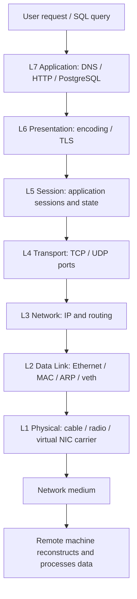

## OSI compared with practical Internet networking

| OSI | Concept | Examples | Typical evidence |
|---|---|---|---|
| 7 Application | Application protocol and names | DNS, HTTP, PostgreSQL, SSH, Kubernetes API | `dig`, `curl`, `psql`, service logs |
| 6 Presentation | Representation and security | TLS, certificates, serialization, encoding | `openssl s_client`, `curl -v` |
| 5 Session | Ongoing logical dialogue | Auth sessions, token refresh, keepalive, stateful protocols | App logs, session counters, token TTL |
| 4 Transport | Process-to-process transport | TCP, UDP, source/destination ports | `ss`, `nc`, `tcpdump`, `conntrack` |
| 3 Network | Host-to-host delivery | IPv4/IPv6, ICMP, routes, tunnels | `ip route`, `tracepath`, `ping`, `tcpdump` |
| 2 Data Link | Local-link framing | Ethernet, VLAN, bridge, veth, ARP (L2/L3 boundary) | `ip neigh`, `bridge`, `arping` |
| 1 Physical | Transmission path | NIC, physical cable, VM adapter status | `ethtool`, `ip link`, hypervisor UI |

**Clarifications:** DNS is L7 even though it normally uses UDP/TCP on port 53 (L4). TLS is usually described as L6 for teaching but is implemented above TCP in real stacks. ARP maps IPv4 to link-layer addresses and straddles the L2/L3 boundary. Calico routing, CNI and policy affect several layers.

## Three questions before any command

1. **Where is the client?** Your host, a VM, a Docker container, a Kubernetes Pod, or a remote laptop?
2. **What is the actual destination?** Hostname, resolved IP, Service ClusterIP, Pod IP, Node IP, port, transport protocol, TLS name?
3. **What is the exact symptom?** Timeout, refused, name not found, reset, certificate failure, HTTP 503, `password authentication failed`?

The symptom determines the next test. Do not automatically ping everything; many valid networks deliberately block ICMP.

---

# 2. One end-to-end packet journey

## Example topology (illustrative, replace addresses)

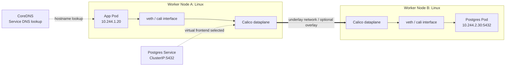

A Kubernetes **Service IP is virtual**: traffic to it is steered to a ready endpoint by the cluster's chosen service dataplane. Usually this is kube-proxy in iptables/nftables/IPVS-based setups; Calico eBPF can replace kube-proxy. DNS maps the Service name to the ClusterIP; the subsequent transport reaches a Pod endpoint. Do not picture every packet as physically travelling through a separate “Service Pod.”

## Encapsulation: why a TCP failure can be a network issue

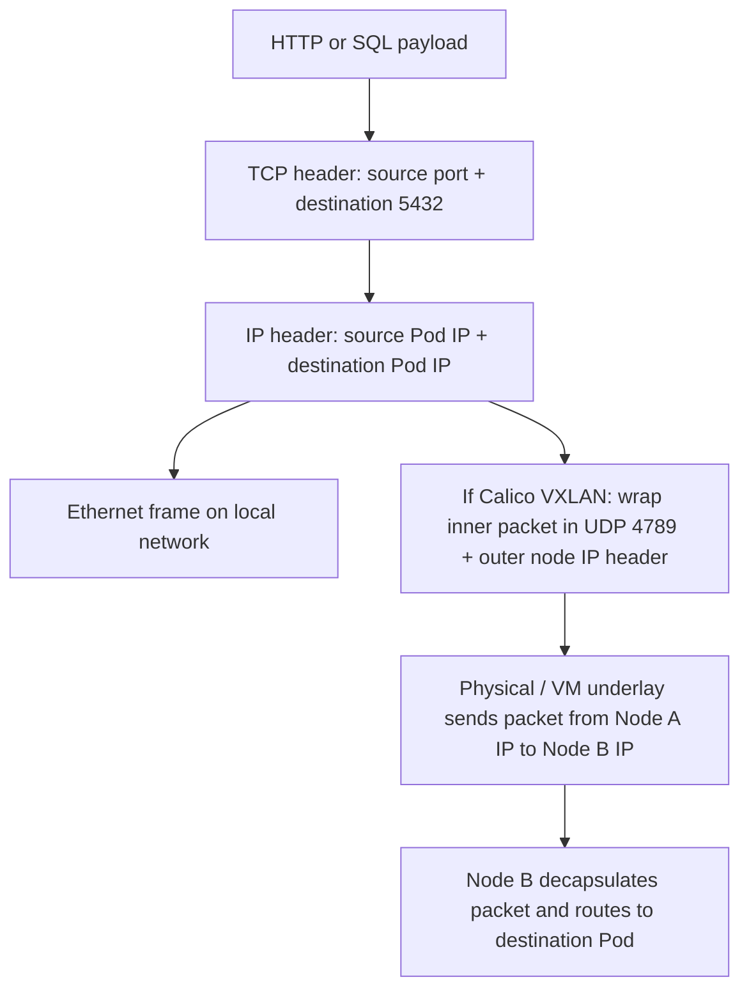

**Mental distinction:**

- **Underlay** = real network between Kubernetes nodes (e.g., `192.168.56.11` to `192.168.56.12`).
- **Overlay** = Pod traffic carried through a tunnel across the underlay (if enabled).
- **Container interface** = logical network interface in a Linux network namespace.
- **Service dataplane** = way to steer Service IP/port traffic to a backend; separate concern from Pod IP routing.

If same-node Pod traffic works but cross-node Pod traffic fails, check Calico encapsulation, routing, MTU, and underlay rules **before** blaming PostgreSQL.

---

# 3. Recognize your operating system and topology

## 3.1 Baseline inventory (**READ-ONLY**; most commands work on all distributions)

```bash
cat /etc/os-release
uname -r
hostnamectl
ip -br link
ip -br address
ip route show
ip -6 route show
ip rule show
ss -lntup
cat /etc/resolv.conf
systemctl --failed
```

Ask: Is this a **bare-metal machine, VirtualBox guest, Docker host, or Kubernetes node**? The visible NIC and network stack differ.

## 3.2 Operating system differences

| Feature | Ubuntu Server | AlmaLinux 8/9/10 | CentOS Stream 8/9/10 |
|---|---|---|---|
| Packages | `apt` | `dnf` | `dnf` (Stream 8/9/10) |
| Usual network configuration | Netplan using networkd or NetworkManager (verify) | NetworkManager with `nmcli` | NetworkManager with `nmcli` |
| Inspect interfaces/routes | `ip`, `ss`, `ethtool` | same | same |
| Network manager diagnostics | `networkctl`, `resolvectl`, `netplan`, or `nmcli`, according to renderer | `nmcli`, `journalctl -u NetworkManager` | `nmcli`, `journalctl -u NetworkManager` |
| Common firewall frontend | `ufw` when enabled; inspect `nft`/iptables backend | `firewalld` when enabled; inspect `nft` | `firewalld` when enabled; inspect `nft` |
| Mandatory access control | AppArmor commonly | SELinux commonly | SELinux commonly |

**Version warning:** CentOS Linux 7/8 are obsolete; CentOS Stream is a different release line. Calico compatibility depends on your **actual kernel and Kubernetes versions**, not just the distro family. Check the Calico support matrix [R4].

## 3.3 Optional tools (install only where permitted)

```bash
# Ubuntu
sudo apt update
sudo apt install -y iproute2 iputils-ping traceroute iputils-arping \
  tcpdump dnsutils netcat-openbsd curl openssl ethtool conntrack \
  jq lsof mtr-tiny

# AlmaLinux / CentOS Stream (some optional packages may require EPEL)
sudo dnf install -y iproute iputils traceroute tcpdump \
  bind-utils nmap-ncat curl openssl ethtool conntrack-tools \
  jq lsof
```

Tools absent inside minimalist containers? **Expected**. Don't install arbitrary debugging tools into production images. Prefer an authorized disposable debug Pod/container.

## 3.4 VirtualBox networking modes matter

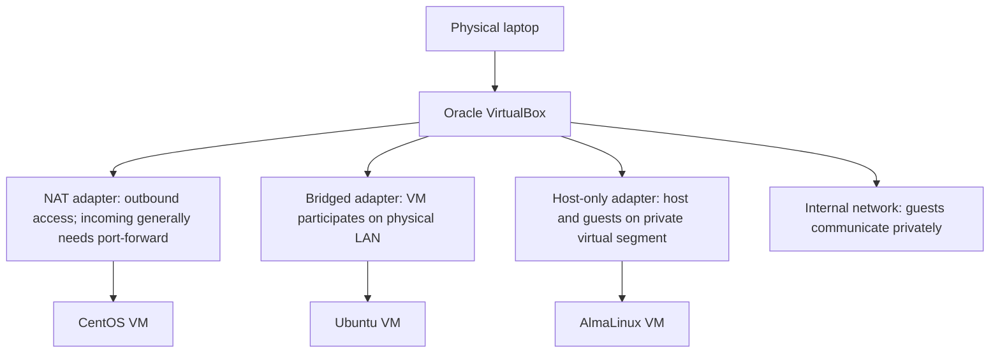

For multi-node kubeadm labs: confirm each VM has **stable mutual reachability** on its node IP. NAT alone often does not provide convenient direct inbound connectivity. A lab might use NAT for internet + host-only for cluster nodes, or properly configured bridged networking. Ensure Pod CIDR and Service CIDR do not overlap with VM/LAN/VPN subnets.

---

# 4. Layer 1 — physical and virtual link

**Question:** Is there an operational path to send bits? The OS/network card could exist yet have no carrier. A VM adapter can be disconnected even if the physical laptop Wi-Fi works.

## Symptoms

- Interface `DOWN` or `NO-CARRIER`; no link speed; physical unplugged cable or down switch port.
- VirtualBox adapter disabled / wrong attached network; guest sees no usable NIC.
- Kubernetes node `NotReady` after VM loses connectivity (could also have unrelated causes).

## Commands on the Linux host (**READ-ONLY**)

```bash
ip -br link                 # interface UP/DOWN and carrier cues
ip -s link show dev <IFACE> # RX/TX errors, dropped packets
ethtool <IFACE>             # physical NIC link, speed, duplex if supported
ethtool -S <IFACE>          # driver counters if supported
journalctl -k -n 100 --no-pager
lspci -nn | grep -Ei 'ethernet|network' # VM support varies
```

**Interpret:**

- `state DOWN` may mean administratively down, driver or virtual-link issue.
- `NO-CARRIER` may mean no physical/virtual link. Not all virtual devices expose meaningful carrier information.
- Rising `rx_errors`/`tx_errors` suggest lower-layer transport/interface problems.
- In a VM, check VirtualBox **Settings → Network → Cable Connected / Adapter Type / Attached To**.

## Docker / Kubernetes application

- Docker's `veth`, `docker0` and Calico `cali*` are **virtual** interfaces. No copper cable connects Pod A to Pod B.
- If a Kubernetes node is inaccessible, check node/VM NIC first; if only one Pod is failing, node physical link probably isn't the only explanation.
- `kubectl get nodes -o wide`; `kubectl describe node <NODE>` then inspect that host.

**Next action:** If link is healthy, move to L2/L3. If host loses carrier, fix switch/cable/VirtualBox network before changing Kubernetes YAML.

---

# 5. Layer 2 — Ethernet, MAC, ARP, bridge and veth

**Question:** On the local link, can the OS discover the next-hop hardware address and send frames there?

## Terms

- **MAC address**: link-layer identifier for an interface, typically within a local broadcast domain.
- **Ethernet frame**: carries data over L2 segments.
- **ARP**: finds a MAC address for a local IPv4 next-hop IP. IPv6 uses Neighbor Discovery instead.
- **Linux bridge**: virtual L2 switch; connects bridge ports.
- **veth pair**: virtual Ethernet cable with two ends; often one end in a container namespace, other on host.
- **VLAN**: logically separates L2 broadcast domains.
- **VXLAN**: encapsulates L2-like overlay traffic over UDP/IP; Calico uses it to carry Pod IP traffic across nodes (not synonymous with Docker's bridge).

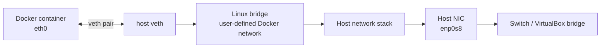

This diagram is for a **typical standalone Docker bridge**. Calico-backed Kubernetes Pods have a different network construction and routing path.

## Commands (**READ-ONLY**)

```bash
ip -d link show
ip neigh show
bridge link show
bridge fdb show
ip -s link show <IFACE>
# If you know two same-L2 IPv4 hosts and arping is installed:
sudo arping -I <IFACE> <NEIGHBOR_IP> -c 3
# Observe ARP without changing configuration:
sudo tcpdump -ni <IFACE> arp
```

### Interpret `ip neigh`

| State | Meaning | Action |
|---|---|---|
| `REACHABLE` | Recently confirmed reachable at L2 | If higher-level traffic fails, investigate L3+ |
| `STALE` | Cached; needs validation on next use | **Not** automatically a failure |
| `INCOMPLETE` | ARP/neighbor resolution still pending | Check adjacency and ARP responses |
| `FAILED` | Neighbor resolution failed | Wrong subnet, VLAN, firewall/ARP filtering, guest isolation |

**Important:** You do not ARP for a remote Internet server; you ARP for the **next-hop gateway** when destination is off-subnet.

## Kubernetes/Calico specifics

```bash
# Host view of interfaces
ip -br link | grep -E 'cali|tunl|vxlan|eth|enp'
ip -d link show vxlan.calico  # only exists if relevant Calico mode enabled
ip -d link show tunl0         # only exists if relevant IP-in-IP mode enabled
```

- A missing `vxlan.calico` device is **not** evidence of failure if Calico uses unencapsulated routing, IP-in-IP or a different dataplane.
- A missing `docker0` bridge is **not** evidence of failure for Kubernetes using containerd and Calico.
- VirtualBox host-only and bridged modes differ at L2, and can affect node reachability.

---

# 6. Layer 3 — IP, subnetting, routing, NAT and ICMP

**Question:** Does the kernel know how to send an IP packet toward the destination and is a valid return route available?

## Essentials

- `10.244.1.20/24` means a Pod IP and an associated subnet mask; `/24` means the first 24 address bits are the network prefix.
- **Default route** normally forwards packets whose destinations are not handled by a more specific route.
- **Routing is directional**: both directions matter. A SYN can arrive yet SYN-ACK return on the wrong path.
- **NAT** may rewrite addresses/ports (Docker published ports, Pod egress, NodePort implementations). Verify where NAT occurs rather than assuming.
- **ICMP** is useful for diagnostics but may be filtered; lack of a ping reply alone proves little.
- **MTU** controls packet size on a link. Encapsulation (e.g., VXLAN) adds headers and can make the effective Pod MTU smaller than underlay MTU.

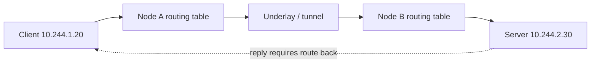

## Host commands (**READ-ONLY**)

```bash
ip -br addr
ip route
ip -6 route
ip rule
ip route get <DESTINATION_IP>   # selected route/source/interface
ping -c 3 <DESTINATION_IP>      # ICMP only
tracepath <DESTINATION_IP>       # when installed; may be filtered
sysctl net.ipv4.ip_forward      # important for router/node forwarding
sysctl net.ipv4.conf.all.rp_filter
sudo nft list ruleset            # firewall/NAT view; access controlled
sudo iptables-save              # if iptables-compatible dataplane in use
```

### How to read `ip route get`

Example:

```text
192.0.2.50 via 192.0.2.1 dev enp0s8 src 192.0.2.10
```

Meaning: To reach `192.0.2.50`, the kernel plans to use gateway `192.0.2.1`, interface `enp0s8`, and source `192.0.2.10`.

If routing is wrong, check IP/mask, configured gateway, multiple default routes, policy routing (`ip rule`), subnet overlap, VPN software and overlay routing. Do not blindly add static routes in a Calico-managed cluster; Calico may own them.

## Routing diagnostic table

| Symptom | Possible interpretation | Confirm |
|---|---|---|
| `Network is unreachable` | No matching route | `ip route get` |
| `No route to host` | Rejected/failed path or local error | `ip route`, neighbor state, `tcpdump` |
| Ping works, TCP fails | L3 may work; L4/app may not | `nc`, `ss`, packet capture |
| Same-node Pods work, cross-node fail | Calico underlay/overlay, MTU, BGP/route | Node-to-node capture + Calico checks |
| Small traffic works, large HTTPS fails | MTU/MSS/fragmentation black hole possible | `tracepath`, packet capture, path MTU tests |

### IPv4 fragmentation/MTU test (only if ICMP allowed)

```bash
# 1472-byte ICMP payload + 28 bytes IPv4/ICMP headers = 1500-byte IPv4 packet
ping -c 2 -M do -s 1472 <DESTINATION_IP>
# Lower payload gradually to find path MTU; VPN/overlay may need less.
```

Interpret carefully: a failure might reflect ICMP filtering, rather than MTU. For TCP flows, corroborate with `tcpdump` and MSS behavior.

---

# 7. Layer 4 — TCP, UDP, sockets and connection tracking

This is often the most important layer for DevOps interviews, and the best place to learn **causal diagnosis**.

## 7.1 What does a port mean?

An **IP address** identifies a network endpoint. A **port** identifies a socket/service within that endpoint. PostgreSQL commonly listens on **TCP 5432**; Kubernetes API server commonly uses **TCP 6443**; DNS often uses **UDP 53** and sometimes TCP 53.

A client connection has a **5-tuple**:

```text
Protocol | Source IP | Source port | Destination IP | Destination port
TCP      | 10.244.1.20 | 43872    | 10.244.2.30    | 5432
```

Source port is often ephemeral (chosen by OS). The destination port identifies the requested service. Firewalls, NAT and conntrack care about these tuples.

## 7.2 The TCP three-way handshake

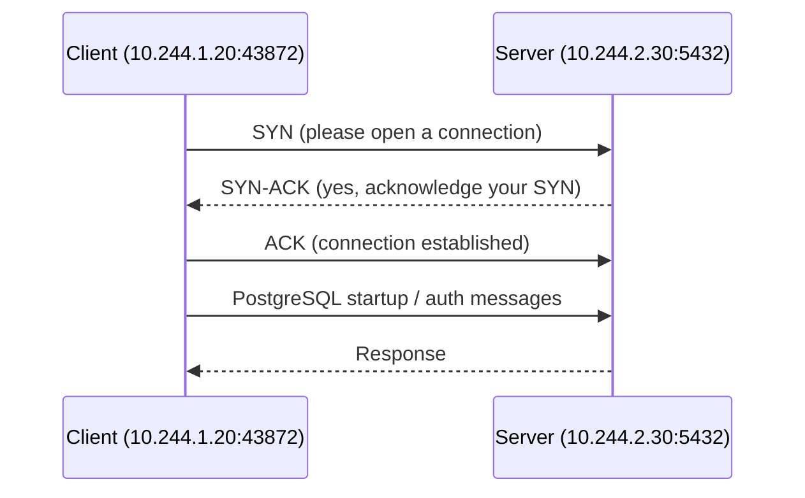

### Failures and how they look

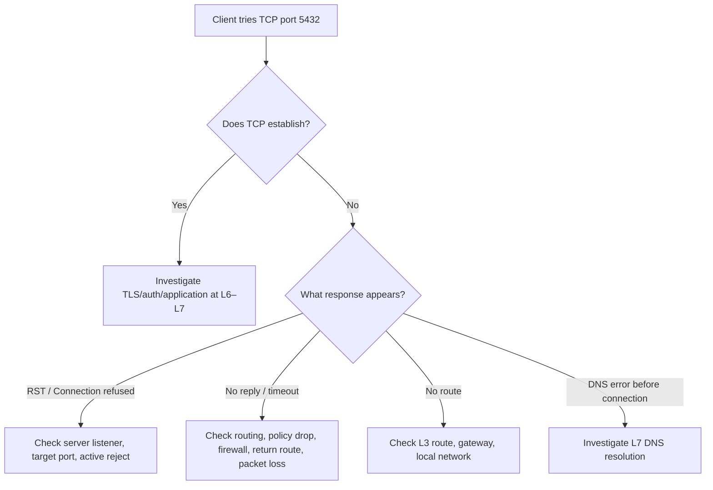

**Subtlety:** `connection refused` means an active refusal, often TCP RST; it does **not** prove the host is healthy or the service exists. A firewall can actively reject too. `timeout` means no successful reply in time, **not** automatically a firewall; return-path failure, server overload or packet loss can also explain it.

## 7.3 Read-only commands on Linux

```bash
# Is anything listening on TCP 5432?
sudo ss -lntp '( sport = :5432 )'
# All listening TCP + UDP sockets
sudo ss -lntup
# TCP socket states
ss -tan
# Processes associated with port, if lsof present
sudo lsof -nP -iTCP:5432 -sTCP:LISTEN
# Test only TCP establishment from a client (Ncat/OpenBSD nc syntax)
nc -vz -w 3 <DESTINATION_IP> 5432
# Show per-connection state details
ss -tin
# Kernel TCP statistics / retransmissions
nstat -az | grep -E 'TcpRetransSegs|TcpExtTCPSynRetrans|TcpExtTCPLoss'
```

If `ss` shows `127.0.0.1:5432` **only**, the service is bound to loopback; a remote client generally cannot reach it. A listener on `0.0.0.0:5432` accepts on all IPv4 local addresses (subject to firewall and application rules). IPv6 listeners depend on `IPV6_V6ONLY` and OS configuration.

### TCP socket state cheat sheet

| State | Meaning | When to worry |
|---|---|---|
| `LISTEN` | Server waits for connections | Missing listener when needed |
| `SYN-SENT` | Client sent SYN and awaits response | Persistent state suggests no SYN-ACK |
| `SYN-RECV` | Server received SYN and waits for client ACK | Many stuck connections can indicate incomplete handshakes |
| `ESTAB` | TCP connection established | App may still fail at TLS/auth |
| `TIME-WAIT` | Normal TCP cleanup state | Large count alone isn't proof of defect |
| `CLOSE-WAIT` | Peer closed; local app has not closed socket | Persistent accumulation may indicate app resource leak |

## 7.4 Packet capture: the most informative test

Run on a node or endpoint where permitted:

```bash
sudo tcpdump -ni any -tttt -vv 'tcp port 5432'
# Or focus on server IP + port:
sudo tcpdump -ni any -tttt 'host <DB_IP> and tcp port 5432'
# Optional bounded packet sample to a protected local file:
sudo tcpdump -ni <IFACE> -c 100 -w /tmp/db-5432.pcap 'tcp port 5432'
```

Packets can contain **credentials and user data**: apply least privilege, short captures, approved storage and retention, and never share raw captures indiscriminately. `-i any` can show packets from more than one interface and duplicate-looking entries. On VXLAN you may see **outer UDP 4789** at underlay NIC and **inner TCP 5432** after decapsulation; choose interfaces appropriately.

### Interpret traces

```text
SYN -> SYN -> SYN              = SYN retransmission; reply absent
SYN -> RST-ACK                = active refusal / reject
SYN -> SYN-ACK -> ACK         = TCP handshake succeeded
ACK + payload then RST        = connection reset after establishment
Handshake succeeds, auth fails = application-level error
```

**One of the strongest isolation methods:** Capture at **client**, **intermediate node**, and **server**. Locate where the SYN disappears, or where a reply fails to return.

## 7.5 UDP is not TCP

UDP has **no three-way handshake**, no built-in delivery guarantee, and a `nc -uz` result may be ambiguous. A silent UDP application can be healthy, blocked or unavailable. Test using the **application protocol**, then capture:

```bash
# DNS UDP request actually validates DNS response
dig @<DNS_SERVER_IP> example.org A +time=2 +tries=1
# Force DNS over TCP
dig +tcp @<DNS_SERVER_IP> example.org A
# Observe DNS traffic:
sudo tcpdump -ni any 'udp port 53 or tcp port 53'
```

## 7.6 Connection tracking (conntrack) and firewalls

Linux netfilter connection tracking helps NAT and stateful filtering identify related return packets:

```bash
sudo conntrack -L -p tcp 2>/dev/null | head  # if installed, requires privilege
sudo sysctl net.netfilter.nf_conntrack_count
sudo sysctl net.netfilter.nf_conntrack_max
sudo nft list ruleset
```

Do not interpret a large conntrack count alone as exhaustion; compare it to max and kernel logs, connection failure rate and packet evidence. Do not flush conntrack tables in production to “fix” connectivity.

## 7.7 Kubernetes Layer-4-specific clues

```bash
kubectl get svc -n tools
kubectl describe svc postgres -n tools
kubectl get endpointslices -n tools -l kubernetes.io/service-name=postgres -o wide
kubectl get pods -n tools -o wide
# Run from an existing Pod ONLY if it has nc:
kubectl exec -n tools <APP_POD> -- nc -vz -w 3 postgres.tools.svc.cluster.local 5432
```

If the Service port is **5432** but targetPort is **5433**, and PostgreSQL listens on **5432**, the virtual Service frontend may resolve while connections fail. If the Service has no **ready endpoints**, check selectors, Pod labels, readiness and EndpointSlice conditions. See [R2].

**Interview answer:** “I identify DNS name and destination IP first, then verify Service endpoints, check listener with `ss`, initiate a TCP test, and capture SYN/SYN-ACK/RST on the correct interfaces. I classify timeout versus active refusal before touching firewall rules.”

---

# 8. Layer 5 — sessions and state

In the OSI teaching model L5 manages a logical conversation between applications. Modern Linux does not provide a universal command called “Layer 5 status.” Often functionality is embedded in applications: authenticated login session, PostgreSQL connection pool, HTTP keep-alive, SSH login, WebSocket session, Keycloak token lifecycle. TCP connection state at L4 and netfilter **conntrack state** are related but **not the same** as an authenticated user session.

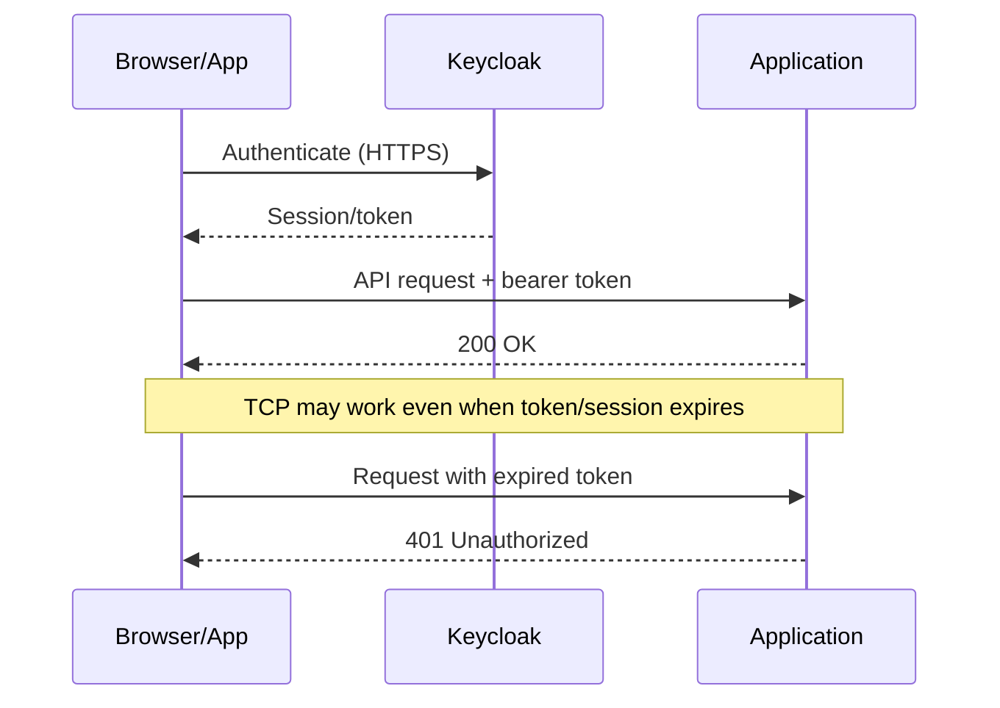

### Layer-5-style symptoms

- Login succeeds but every subsequent request is unauthorized.
- WebSocket upgrades but disconnects after a short, consistent interval.
- DB client connects but pooled sessions are closed after idle time.
- Reverse proxy has an idle timeout shorter than the application's expected session lifetime.

### Investigation

```bash
# Host TCP state (L4 evidence, not proof of app session validity)
ss -tan
# HTTP response headers/cookies (sensitive values; redact)
curl -sS -D - -o /dev/null https://<APP_HOST>/health
# Application/Keycloak/reverse proxy logs
kubectl logs -n tools <APP_POD> --since=10m
# Date/time drift can break expiring sessions and TLS
timedatectl status
```

Find out which component *owns* session state: Keycloak, API service, database pool, reverse proxy or client. Inspect session TTL, timeout, sticky-session requirements where applicable, token validity, proxy headers and clock synchronization. Never treat `401` as a Calico routing error without contrary evidence.

---

# 9. Layer 6 — TLS, certificates and encoding

TLS encryption/authentication is commonly discussed as L6 even though it sits above TCP in the implemented stack.

### A TLS handshake can fail when TCP works

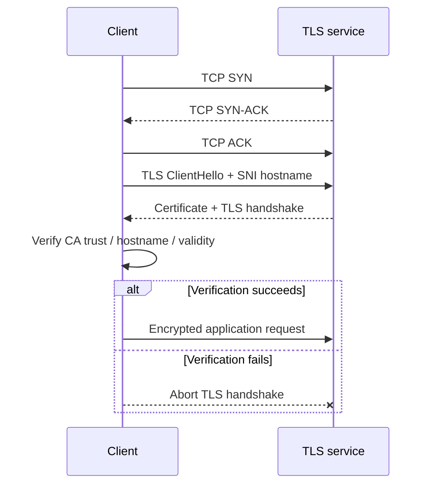

**Troubleshooting causes:** expired certificate; untrusted CA; missing certificate chain; wrong SAN/hostname; incorrect SNI; clock skew; unsupported TLS versions/ciphers; mutual-TLS client certificate missing. For internal services, check whether TLS is configured at ingress, proxy, sidecar, database itself, or multiple points.

### Commands (**READ-ONLY**)

```bash
# HTTP+TLS trace: resolves hostname, opens TCP, negotiates TLS and makes HTTP request
curl -vI --connect-timeout 5 https://<HOSTNAME>/
# Inspect presented server certificate and hostname
openssl s_client -connect <HOSTNAME>:443 -servername <HOSTNAME> \
  -verify_hostname <HOSTNAME> -showcerts </dev/null
# Display certificate metadata for a local cert file
openssl x509 -in server.crt -noout -subject -issuer -dates -ext subjectAltName
# Verify system time
timedatectl status
```

**Do not use `curl -k` as the final “fix.”** It disables certificate verification and hides the precise security failure. Use insecure mode only when explicitly authorized for a controlled experiment; do not put it in production configuration.

For Kubernetes:

```bash
kubectl get ingress -A
kubectl describe ingress <INGRESS> -n <NAMESPACE>
kubectl get secret -n <NAMESPACE>             # names/types only
kubectl logs -n <INGRESS_NAMESPACE> <INGRESS_CONTROLLER_POD> --tail=100
```

Treat secret contents and TLS private keys as sensitive; never print them to your interview notes.

---

# 10. Layer 7 — DNS, HTTP, database protocols and application health

**Question:** After name resolution and transport/TLS work, is the application actually providing the requested operation?

## 10.1 DNS diagnosis

```bash
# Host DNS lookups
getent ahostsv4 example.org
dig example.org A
dig example.org AAAA
dig @<DNS_SERVER_IP> example.org A
cat /etc/resolv.conf
# On a host using systemd-resolved
resolvectl status
resolvectl query example.org
```

### DNS results mean different things

| Result | Likely category | Next check |
|---|---|---|
| `NXDOMAIN` | Requested DNS name does not exist in answering zone | Typo, service name, namespace, search path |
| `SERVFAIL` | Resolver failed to answer successfully | CoreDNS/upstream/provider logs and reachability |
| `timeout` | Query timed out | NetworkPolicy, UDP/TCP 53 route, DNS service availability |
| Correct A record, TCP fails | DNS likely not root cause for this request | L3/L4/service backend |
| Host resolves, Pod does not | Different resolver path/configuration | `/etc/resolv.conf` inside Pod, CoreDNS, policy |

Kubernetes Service DNS is generally `service.namespace.svc.cluster.local` when the cluster domain is `cluster.local` (verify configured domain). A Pod in the **same** namespace may use a short Service name; cross-namespace traffic should use qualified names. See [R3].

```bash
# DNS from a Pod that already contains nslookup:
kubectl exec -n tools <APP_POD> -- \
  nslookup postgres.tools.svc.cluster.local
kubectl exec -n tools <APP_POD> -- cat /etc/resolv.conf
kubectl get svc kube-dns -n kube-system
kubectl get pods -n kube-system -l k8s-app=kube-dns
kubectl logs -n kube-system -l k8s-app=kube-dns --tail=100
```

If the app image lacks `nslookup`, use an approved diagnostic Pod (lab in section 18). **NetworkPolicy applies to the source debug Pod too** and can produce different results if labels/namespace differ; ideally debug from the same network context as the application.

## 10.2 HTTP/HTTPS

```bash
curl -v http://<HOST>:<PORT>/health
curl -i --max-time 10 https://<HOST>/ready
curl -w 'dns=%{time_namelookup} connect=%{time_connect} tls=%{time_appconnect} total=%{time_total}\n' \
  -o /dev/null -sS https://<HOST>/
```

HTTP status distinctions: `200` may indicate success for that endpoint; `401/403` means authentication/authorization issue; `404` suggests route/path mismatch; `502/503/504` often implicate a proxy/upstream and require inspecting **both sides**. Status codes alone do not identify a complete root cause.

## 10.3 PostgreSQL example

```bash
# From an authorized host with PostgreSQL client tools:
pg_isready -h <POSTGRES_HOST> -p 5432 -t 3
# If you have credentials and permission:
psql 'host=<POSTGRES_HOST> port=5432 dbname=<DB> user=<USER> sslmode=require' \
  -c 'SELECT 1;'
```

- `nc -vz ... 5432` proves only a TCP connection could be established (depending on tool semantics).
- `pg_isready` checks whether a PostgreSQL server is accepting connections; it does not prove that a specific username/password or database query works.
- `psql SELECT 1` with real authorized credentials demonstrates a more complete application-path check.

## 10.4 Other data platform protocols you used

| Service | Common ports (deployment-dependent) | Useful application test |
|---|---|---|
| PostgreSQL | TCP 5432 | `pg_isready`, `psql SELECT 1` |
| MySQL | TCP 3306 | `mysql -h ... -e 'SELECT 1'` |
| MongoDB | TCP 27017 | `mongosh` ping with auth |
| Trino | HTTP 8080, or HTTPS as configured | `curl /v1/info`, CLI `SHOW CATALOGS` |
| MinIO | S3 API commonly TCP 9000 | Health/ready endpoint with correct host and mode |
| Hive Metastore | Thrift commonly TCP 9083 | Client metadata query / logs |
| Keycloak | HTTP 8080 internally, fronted by TLS ingress | Relevant health/realm/OpenID config endpoint |
| Kubernetes API | TCP 6443 in common kubeadm setups | `kubectl cluster-info`, `kubectl get --raw=/readyz` |

These are **common conventions**, not guarantees about your deployment.

---

# 11. Distro-specific runbooks

## 11.1 Ubuntu

```bash
# COMMON read-only commands
ip -br a && ip r && ss -lntup
ls -l /etc/netplan/
networkctl status       # if systemd-networkd used
resolvectl status       # if systemd-resolved used
sudo netplan get         # if installed
sudo netplan status      # on supported versions
sudo ufw status verbose  # when ufw installed
sudo nft list ruleset
journalctl -u systemd-networkd -n 100 --no-pager
journalctl -u systemd-resolved -n 100 --no-pager
```

Netplan is a **configuration layer**; the actual backend may be networkd or NetworkManager. Inspect instead of assuming. If `resolvectl` is absent or systemd-resolved is disabled, inspect the configured resolver directly. For remote networks, do not use `netplan apply` blindly: a typo can disconnect SSH.

## 11.2 AlmaLinux / CentOS Stream (RHEL family)

```bash
nmcli general status
nmcli device status
nmcli connection show
nmcli -f GENERAL,IP4,IP6 device show <IFACE>
ip -br a
ip route
resolvectl status                   # only if resolved is used
sudo firewall-cmd --state           # if firewalld installed
sudo firewall-cmd --list-all        # active zone, when firewalld running
sudo firewall-cmd --get-active-zones
sudo nft list ruleset
getenforce                            # SELinux mode, if installed
sudo ausearch -m AVC -ts recent     # if audit tools installed
journalctl -u NetworkManager -n 100 --no-pager
```

NetworkManager can unexpectedly attempt to manage Calico interfaces. Follow Calico's documented method for marking its `cali*`, `tunl*`, or VXLAN-related interfaces unmanaged **only when applicable**, using your exact Calico/version guidance [R4], [R13]. SELinux denials are a separate diagnostic possibility, but **do not disable SELinux** as a generic fix.

### Important firewall nuance with Calico

Calico documentation warns that host firewall managers may conflict with Calico-managed rules [R4]. This does **not** mean “turn off security” on every host. In existing clusters, inventory firewall ownership and approved host policies first; coordinate with security/change controls and validate the exact supported Calico dataplane and firewall approach.

## 11.3 Common differences that are *not* OSI differences

- A `tcpdump` diagnosis works conceptually the same on Ubuntu and AlmaLinux; package/daemon administration differs.
- Linux namespace, veth, routing and TCP behavior come from the **kernel**, not from Kubernetes itself.
- Docker's firewall rules and Calico's rules are not interchangeable. Inspect the real dataplane (iptables/nftables/eBPF), not just the distro's firewall frontend.

---

# 12. Docker networking from start to finish

## 12.1 Standalone Docker vs Kubernetes

Docker Engine normally provides networks such as `bridge`, `host`, `none`, `macvlan`, `ipvlan`, and, in Swarm environments, `overlay`. Kubernetes with **containerd + Calico** uses CRI/CNI and Calico networking; `docker ps` on a node does **not** necessarily list Kubernetes containers [R7], [R8].

## 12.2 Docker bridge and published port

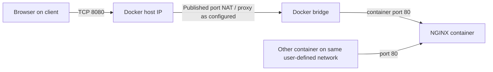

Example **LAB CHANGE**:

```bash
# Create a named network (automatic name-based DNS within that network)
docker network create lab-net
# Create NGINX; bind host port to loopback ONLY for a safer local lab
docker run -d --name web --network lab-net -p 127.0.0.1:8080:80 nginx:stable
# Observe
curl -v http://127.0.0.1:8080/
docker ps
docker port web
docker inspect web
docker network inspect lab-net
docker logs --tail=100 web
docker exec web sh -c 'cat /etc/nginx/conf.d/default.conf'
# Cleanup when finished
docker rm -f web
docker network rm lab-net
```

## 12.3 Troubleshooting Docker by symptom

| Failure | Diagnosis | Commands |
|---|---|---|
| `docker run` fails to create network | Docker daemon or firewall/backend | `systemctl status docker`, `journalctl -u docker`, `docker info` |
| `localhost:8080` refused | No listener/mapping/container exited | `docker ps -a`, `docker port`, `docker logs`, `ss -lntp` |
| Host works, remote fails | Bound to `127.0.0.1` or external firewall | `docker port`, `ss`, firewall rules, route |
| Container cannot resolve another container | Default bridge vs user-defined, names/DNS | `docker network inspect`, `docker exec ... cat /etc/resolv.conf` |
| Containers on different Docker bridges cannot connect | Network isolation | Shared user-defined network or explicit authorized routing/published port |
| Container reaches IP but not hostname | Container DNS | `docker inspect`, resolv.conf, resolver test |
| Container-to-external timeout | Gateway/NAT/DNS/firewall | `docker network inspect`, route, `nft`, `tcpdump` |

## 12.4 Container network namespace inspection

```bash
# Host-side Docker PID and netns view (root permissions required)
docker inspect -f '{{.State.Pid}}' web
sudo nsenter -t <CONTAINER_PID> -n ip addr
sudo nsenter -t <CONTAINER_PID> -n ip route
sudo nsenter -t <CONTAINER_PID> -n ss -lntup
```

For a stopped container the PID may be 0. The host may have only part of the toolchain installed. `nsenter` on a production container namespace requires authorization and should be read-only unless explicitly approved.

**Crucial distinction:** Docker's default `bridge` does not provide automatic container-name resolution like a user-defined bridge; the latter does [R7]. Publishing `-p 8080:80` exposes a host port and may bind more broadly than intended [R8].

---

# 13. kubeadm + Kubernetes networking from start to finish

## 13.1 What kubeadm does, and what it does NOT do

- `kubeadm` prepares/bootstraps core cluster components and joins nodes.
- `kubelet` operates on a node and manages Pods with the runtime.
- `kubectl` calls the Kubernetes API.
- `containerd` is a common CRI runtime for Pod containers.
- A **CNI** such as Calico establishes Pod networking; it is a separate installation choice.
- CoreDNS handles cluster DNS.
- A **service dataplane** provides ClusterIP/NodePort behavior: traditional kube-proxy, or another implementation such as Calico eBPF replacement.

Official kubeadm documentation specifically states that a compatible Pod network add-on is needed for Pods to communicate and that Pod CIDRs must not overlap host networks [R1].

## 13.2 Architecture

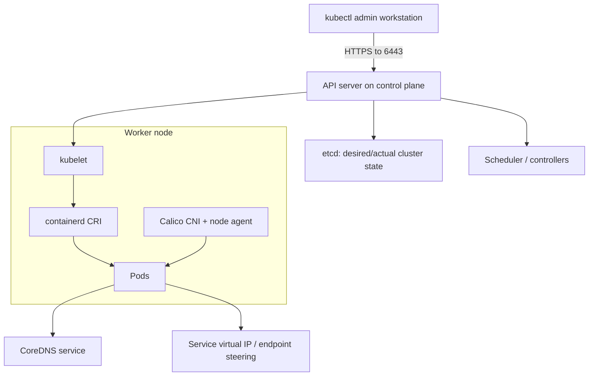

Kubernetes resources to inspect:

```bash
kubectl cluster-info
kubectl get nodes -o wide
kubectl describe node <NODE>
kubectl get pods -A -o wide
kubectl get svc -A
kubectl get endpointslices -A
kubectl get networkpolicy -A
kubectl get events -A --sort-by=.metadata.creationTimestamp
kubectl get ds -A
```

## 13.3 Pod IP vs Service IP vs Node IP

| IP type | Who owns it? | What it means |
|---|---|---|
| Node IP | Linux host/VM | Node-to-node and node control plane traffic |
| Pod IP | CNI/IPAM assignment | Address allocated to a Pod network namespace |
| Service ClusterIP | Kubernetes Service abstraction | Virtual stable frontend for one or more Pods |
| NodePort | Service exposure mechanism | Port served on eligible node addresses (mode-dependent) |
| External/Ingress address | LB/router/ingress controller | Outside access; may include TLS/reverse proxy |

**Key test:** If PodIP works but ClusterIP fails, suspect **Service selection/EndpointSlices/service dataplane**. If both fail across nodes but same-node works, suspect **cross-node Pod routing/overlay/policy**.

## 13.4 containerd / CRI diagnosis on kubeadm nodes

```bash
systemctl status kubelet
systemctl status containerd
sudo journalctl -u kubelet -n 100 --no-pager
sudo journalctl -u containerd -n 100 --no-pager
sudo crictl info
sudo crictl ps -a
sudo crictl pods
sudo crictl logs <CONTAINER_ID>
ls -al /etc/cni/net.d/
ls -al /opt/cni/bin/
```

`crictl` requires a configured CRI endpoint. A common containerd socket is `unix:///run/containerd/containerd.sock` but discover the actual path instead of blindly using it [R9]. If CNI configuration is missing, kubelet may report failures to create Pod sandboxes.

## 13.5 Network debugging from inside the right Pod

```bash
kubectl get pods -n tools -o wide
kubectl describe pod <POD> -n tools
kubectl logs <POD> -n tools --previous   # if container restarted
kubectl exec -n tools <POD> -- cat /etc/resolv.conf
kubectl get svc postgres -n tools -o yaml
kubectl get endpointslices -n tools \
  -l kubernetes.io/service-name=postgres -o wide
```

A Pod's network namespace can have its own routes/DNS and is not equivalent to the host's network namespace. Testing from the host may succeed while testing from a Pod fails, especially when NetworkPolicy differs.

---

# 14. Calico deep dive: policies, overlays, BGP, eBPF

Calico is a networking **and policy** system. Do not assume every Calico cluster has the same dataplane. Inspect first.

## 14.1 Calico vocabulary

| Term | Meaning |
|---|---|
| **CNI** | Plugin mechanism to configure Pod network interfaces/routes |
| **Calico IPAM** | Assigns/manages Pod addresses from configured pools |
| **Felix** | Calico agent responsible for programming forwarding/policy in dataplane |
| **BIRD/BGP** | In relevant Calico modes, distributes Pod routes between nodes/routers |
| **VXLAN** | Carries traffic between nodes using UDP encapsulation (default port 4789) |
| **IP-in-IP** | Encapsulation as IP protocol 4 (no UDP/TCP port); IPv4-focused mode |
| **Unencapsulated/BGP routing** | Underlay routers/nodes must know how to reach Pod ranges |
| **NetworkPolicy** | Controls permitted Pod ingress/egress flows |
| **eBPF dataplane** | Alternative accelerated Calico dataplane that can replace kube-proxy |
| **Typha** | Optional scaling component for Calico control state distribution |

## 14.2 First: find the real install mode

```bash
kubectl get pods -A | grep -Ei 'calico|tigera'
kubectl get daemonsets -A | grep -i calico
kubectl get tigerastatus 2>/dev/null           # operator installs when present
kubectl get installation.operator.tigera.io default -o yaml 2>/dev/null
kubectl get ippools.crd.projectcalico.org -o yaml 2>/dev/null
kubectl get bgpconfigurations.crd.projectcalico.org -o yaml 2>/dev/null
kubectl get felixconfigurations.crd.projectcalico.org -o yaml 2>/dev/null
```

- **Operator installation:** common namespace `calico-system`, operator `tigera-operator`.
- **Manifest installation:** often Calico Pods in `kube-system`.
- Querying an absent CRD returns an error. That is a prompt to check installation/mode, **not necessarily a networking failure**.
- **Dataplane may be iptables, nftables, or eBPF**; find current configuration before trusting specific rule names.

## 14.3 Three routing/encapsulation paths

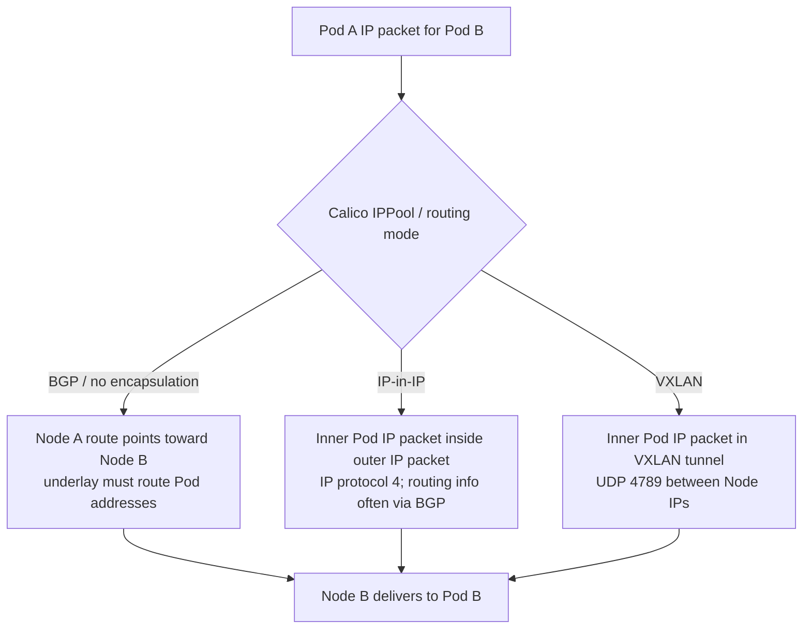

**Mode-dependent firewall requirements** per Calico docs [R4], [R5]:

| Mode | Node-to-node allowance | Why |
|---|---|---|
| BGP | **TCP 179** if BGP peering used | Control-plane route advertisements |
| IP-in-IP | **IP protocol 4** if enabled | Data-plane encapsulated Pod packets |
| VXLAN | **UDP 4789** if configured/default | Encapsulated Pod traffic |
| Typha | **TCP 5473** default if used | Calico internal distribution |
| Kubernetes API | Usually **TCP 6443**, deployment dependent | Cluster/control state |

Important: Allowing TCP 179 **alone** does not allow IP-in-IP data (protocol 4). In a VXLAN-only setup BGP is not required, so `calicoctl node status` BGP checks are not your first diagnostic. **Ports can be customized**; inspect installation.

## 14.4 Calico logs and node state

```bash
# Example operator install
kubectl get pods -n calico-system -o wide
kubectl get ds -n calico-system
kubectl logs -n calico-system <CALICO_NODE_POD> --all-containers=true --tail=100
# Example manifest install
kubectl get pods -n kube-system -l k8s-app=calico-node -o wide
kubectl logs -n kube-system <CALICO_NODE_POD> --all-containers=true --tail=100
# On affected node, relevant when installed:
sudo calicoctl node status
sudo calicoctl node diags
# Kernel routes / interfaces:
ip route
ip -d link
```

Consult the component logs and Calico commands guides [R5], [R6]. `calicoctl` may not be installed on your host; use the approved version matched to your Calico deployment. `node diags` gathers support archives that can contain sensitive infrastructure details; handle them accordingly.

## 14.5 Packet captures for Calico cross-node failure

Run on node NICs with authorization:

```bash
# Calico VXLAN outer traffic
sudo tcpdump -ni <NODE_IFACE> 'udp port 4789'
# Calico IP-in-IP outer traffic
sudo tcpdump -ni <NODE_IFACE> 'ip proto 4'
# BGP control-plane sessions
sudo tcpdump -ni <NODE_IFACE> 'tcp port 179'
# Inner application traffic observed at suitable interface
sudo tcpdump -ni any 'host <POD_IP> and tcp port 5432'
```

If you see outgoing VXLAN packets on Node A but none arriving on Node B: suspect underlay path/firewall. If outer VXLAN arrives on B but inner packets are not delivered: inspect destination node's Calico interfaces, routes, policies and dataplane. If the reply is missing, inspect return path too.

## 14.6 MTU and encapsulation

VXLAN adds overhead to a packet. If the physical/virtual underlay MTU is 1500, an overlay Pod MTU often needs to be smaller. **Do not hardcode a universal Calico MTU:** it depends on encapsulation, IPv4/IPv6, WireGuard, host network and install settings.

```bash
ip link show <NODE_IFACE>
ip link show vxlan.calico  # if VXLAN enabled
kubectl get ippools.crd.projectcalico.org -o yaml 2>/dev/null
tracepath <PEER_NODE_IP>
```

If small requests work but large gRPC/HTTPS/SQL results hang, collect captures and compare TCP MSS, ICMP fragmentation feedback and interface MTUs. MTU issues can masquerade as intermittent application failures.

## 14.7 NetworkPolicy: why same port works from one Pod but not another

**Two-sided policy model:** Kubernetes policy can isolate **source egress** and **destination ingress** independently. Allowing only one direction of the intended *connection* in policy is insufficient if both ends are isolated. Policies are additive for selected Pods, and the CNI must enforce them [R10].

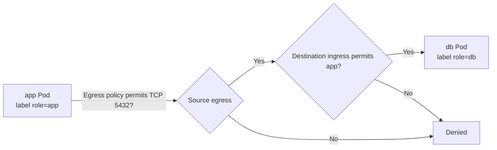

**A small lab-only ingress policy** permitting same-namespace Pods labeled `role: app` to reach a PostgreSQL Pod labeled `role: db` on TCP 5432:

```yaml
apiVersion: networking.k8s.io/v1
kind: NetworkPolicy
metadata:
  name: allow-app-to-postgres
  namespace: tools
spec:
  podSelector:
    matchLabels:
      role: db
  policyTypes:
    - Ingress
  ingress:
    - from:
        - podSelector:
            matchLabels:
              role: app
      ports:
        - protocol: TCP
          port: 5432
```

**What it does:** selects `role=db` Pods, isolates their ingress (unless other policies also allow flows), then allows ingress from matching `role=app` Pods **in the same namespace**. It does **not** add source egress permissions where source Pods are egress-isolated; use an appropriate egress policy as well. **Do not apply this to production without confirming selectors and existing policies.**

Read-only inspections:

```bash
kubectl get networkpolicy -A
kubectl describe networkpolicy allow-app-to-postgres -n tools
kubectl get pods -n tools --show-labels
kubectl get networkpolicies.crd.projectcalico.org -A 2>/dev/null
kubectl get globalnetworkpolicies.crd.projectcalico.org 2>/dev/null
```

Other Calico-specific policy types/global policies/host endpoint rules may also apply; standard Kubernetes `get networkpolicy` might not show every Calico policy.

## 14.8 eBPF changes the diagnostic path

Calico eBPF can implement Kubernetes Service routing directly, replacing kube-proxy [R11]. In that case, searching for kube-proxy **iptables KUBE-SVC chains** is the wrong first step. First inspect whether the cluster runs kube-proxy, which Calico dataplane is configured, and how Services are implemented. For standard mode, kube-proxy may use iptables/nftables/IPVS depending on Kubernetes version/configuration.

**Do not enable/disable eBPF, stop kube-proxy, or migrate encapsulation during incident debugging without a separately reviewed change plan.**

---

# 15. Kubernetes debugging decision tree

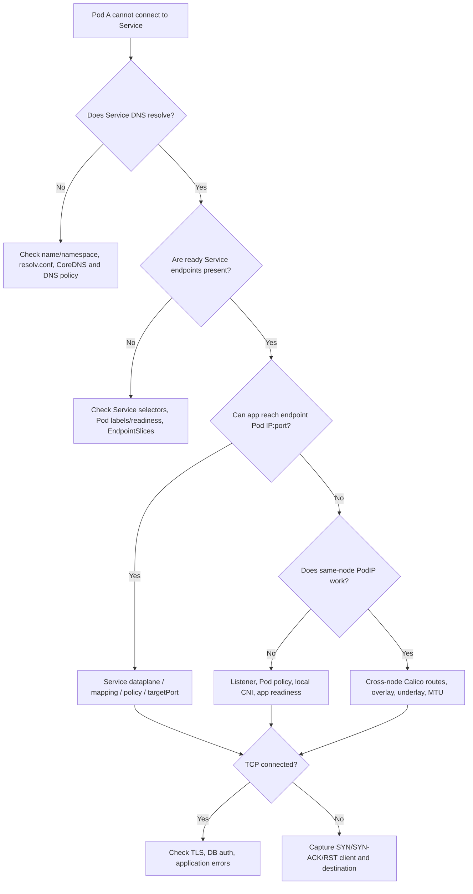

This is intentionally simplified: DNS and application readiness can both be broken; EndpointSlice state and policy may vary with installation. The purpose is to **reduce hypotheses, not declare certainty after one test**.

## Triage commands in a safe order

```bash
# Context before anything else
kubectl config current-context
kubectl get nodes -o wide
kubectl get pods -n tools -o wide
kubectl get svc -n tools
kubectl get endpointslices -n tools
kubectl get networkpolicy -n tools
kubectl describe pod -n tools <APP_POD>
kubectl logs -n tools <APP_POD> --tail=100
# Check relevant node and dataplane
kubectl describe node <NODE>
kubectl get pods -A | grep -Ei 'calico|coredns|kube-proxy'
```

Always note **which namespace** and **which source Pod** you tested from. Debug Pods in an unrestricted namespace can produce misleading success if the actual app has restrictive network policies.

---

# 16. Full incident: app cannot connect to PostgreSQL

### Fictional incident report (for practice)

App in `tools` namespace logs:

```text
could not connect to server: Connection timed out
host=postgres.tools.svc.cluster.local port=5432
```

The word **timeout** is evidence, not a conclusion.

### Step A — Know the path

```bash
kubectl get pod -n tools -o wide
kubectl get svc postgres -n tools -o wide
kubectl describe svc postgres -n tools
kubectl get endpointslices -n tools \
  -l kubernetes.io/service-name=postgres -o yaml
```

Record source Pod IP/node, destination Service ClusterIP, backend Pod IP/node, `port`, `targetPort`, labels and readiness.

### Step B — Check DNS from the client context

```bash
kubectl exec -n tools <APP_POD> -- cat /etc/resolv.conf
# If tool installed:
kubectl exec -n tools <APP_POD> -- \
  nslookup postgres.tools.svc.cluster.local
```

- DNS fails? Use Section 10; verify CoreDNS and policy for TCP/UDP 53.
- DNS succeeds? Note resolved ClusterIP; proceed.

### Step C — Check TCP

```bash
# If image includes nc:
kubectl exec -n tools <APP_POD> -- \
  nc -vz -w 3 postgres.tools.svc.cluster.local 5432
# From DB node or app container where available:
sudo ss -lntp '( sport = :5432 )'
```

- **Refused**? Check Postgres listener, Service endpoint target port, server-side reject.
- **Timeout**? Inspect policy, packet path, routes, reply traffic.
- **Established**? Probe PostgreSQL with `pg_isready`, then authorized `psql`; investigate auth/TLS.

### Step D — Test endpoint IP directly to separate service routing

From the **same application network context** where possible, attempt `<DB_POD_IP>:5432` rather than the Service name. Policy or routing may differ for direct PodIP versus ClusterIP depending on dataplane, so use as comparative evidence, not absolute proof.

- Backend PodIP works, Service fails → selector/endpoint/service dataplane/port mapping are prime suspects.
- Neither works, both Pods on same node → listener/policy/local networking.
- Same-node works but cross-node fails → check Calico underlay/overlay/routing/MTU and policy.

### Step E — Capture packets where they matter

On each relevant node (authorized):

```bash
sudo tcpdump -ni any 'host <APP_POD_IP> and tcp port 5432'
sudo tcpdump -ni <NODE_IFACE> 'udp port 4789'  # VXLAN only
```

Service NAT may change addresses on different capture points. Identify whether you capture **before or after** backend destination translation. A SYN leaving Node A but no packet arriving on Node B means search the network between them. An arriving SYN but no SYN-ACK calls for checking DB listener/policy/return routing.

### Step F — Root cause and verification

Change **only** the confirmed cause under change control: fix Service selector, correct `targetPort`, repair DB listener, correct targeted policy, fix underlay firewall/route or incompatible MTU. **Do not** “fix” by deleting every NetworkPolicy or setting firewall defaults to accept.

After the change:

```bash
kubectl get pods -n tools -o wide
kubectl get endpointslices -n tools -l kubernetes.io/service-name=postgres
kubectl logs -n tools <APP_POD> --since=5m
# Run the following ONLY from an authorized client with cluster DNS/network access
# and PostgreSQL client tools (typically inside an appropriate Pod):
pg_isready -h postgres.tools.svc.cluster.local -p 5432
```

Check repeated behavior from the actual client Pod, and look for sustained success, not only a single lucky request.

---

# 17. Other incident drills

## Incident 1 — Kubernetes node is `NotReady`

- `kubectl describe node` — reason/conditions, network unavailable, taints.
- Host `ip -br link`, route, disk and kubelet/containerd logs.
- Check network to API server (often 6443), certificates, time and runtime health.
- Check Calico Pods and CNI sandbox errors.
- Distinguish node-heartbeat failure from workload application failure.

## Incident 2 — CoreDNS Pod Running but app cannot resolve

- Run `nslookup` from affected network context; check `/etc/resolv.conf`.
- `kubectl get svc kube-dns -n kube-system`, CoreDNS pods/logs.
- Determine if only specific namespace/app fails; check egress NetworkPolicy allowing DNS UDP/TCP 53.
- Confirm service name and namespace; if external DNS fails, inspect upstream DNS.

## Incident 3 — NGINX Docker container works on host but remote browser times out

- `docker port web`, `ss -lntp`, `curl localhost`.
- Confirm whether bound to `127.0.0.1:8080` versus external interfaces.
- Check external client routing/firewall and host/VM adapter mode.
- Inspect Docker's own firewall/NAT backend. Do not modify managed chains blindly.

## Incident 4 — Cross-node Pod traffic fails after switching Calico mode

- Determine actual `IPPool` `vxlanMode`/`ipipMode` and dataplane.
- Verify node IPs and underlay connectivity; allow mode-specific protocols (VXLAN UDP 4789, IP-in-IP protocol 4, BGP TCP 179 where needed).
- Capture source/destination node tunnels; check MTU and reply direction.
- Verify NetworkManager is not taking over Calico-managed interfaces.

## Incident 5 — Browser shows 502/504 at reverse proxy

- Identify which reverse proxy (Ingress, HAProxy, NGINX, external LB) generated the response.
- Confirm backend Service has endpoints and the backend application is Ready.
- Check proxy-to-backend TCP/TLS connection, hostname/SNI, health endpoint and timeouts.
- `502` and `504` require examining proxy logs; do not blame L3 based on status alone.

## Incident 6 — Small request works, large response stalls

- Check MTU/MSS/path MTU especially with Calico overlay or VPN; capture retransmissions.
- Test a route and smaller payload; inspect TLS/app timeouts and resource saturation as alternative hypotheses.

## Incident 7 — Trino catalog appears, but query fails

- DNS resolution + TCP to target database/metastore/MinIO.
- Trino catalog connector settings (catalog config and credentials), endpoint URL, TLS.
- Database/MinIO/Hive logs. Successful `SHOW CATALOGS` alone does not prove data access; run authorized `SHOW SCHEMAS`, `SELECT 1`, etc.

## Incident 8 — NFS volume mounting fails in Kubernetes

- `kubectl describe pod`, `kubectl describe pvc`, PV/PVC binding and events.
- From node (not necessarily from the Pod that never starts): `showmount -e <SERVER>`, `findmnt`, `mount`, routes, firewall and export permissions.
- Determine if path exists, server exports it to node IPs, required NFS ports/services reachable, SELinux/file ownership is correct.

---

# 18. Safe hands-on networking labs

Do these on a private VM or authorized test cluster, not a shared production environment.

## Lab A — Linux: separate DNS, TCP and TLS

1. `ip -br a; ip route get 1.1.1.1` — understand local addresses and route (do **not** assume ICMP to 1.1.1.1 works).
2. `dig example.org A` — see name resolution.
3. `nc -vz -w 3 example.org 443` — test TCP handshake.
4. `curl -vI https://example.org/` — add TLS and HTTP.
5. `openssl s_client -connect example.org:443 -servername example.org -verify_hostname example.org </dev/null` — inspect TLS.
6. Write evidence: “DNS success != TCP success != TLS success != HTTP success.”

## Lab B — Docker: compare a host-local published port and container network

Use Section 12's `lab-net` + nginx commands. Observe:

- `docker network inspect lab-net` gives subnet/attached endpoints.
- `docker port web` shows **127.0.0.1:8080 → 80/tcp**.
- `curl http://127.0.0.1:8080` works on Docker host, but remote clients should **not** rely on loopback-bound host ports being externally accessible.
- `docker logs web` proves HTTP reached NGINX when the request is logged.

Clean up afterwards.

## Lab C — Kubernetes: compare DNS, ServiceIP and PodIP

**Prerequisites:** Access to a disposable namespace where you are authorized to create Pods; cluster DNS and CNI running; existing test Service such as `postgres`. Do **not** send credentials in command-line arguments where process lists would expose them.

Create an optional temporary DNS Pod in a **lab namespace** (**LAB CHANGE**):

```bash
kubectl create namespace net-lab
kubectl run dnsutils -n net-lab --image=busybox:1.36 \
  --restart=Never --command -- sleep 3600
kubectl get pod dnsutils -n net-lab
kubectl exec -n net-lab dnsutils -- nslookup kubernetes.default.svc.cluster.local
kubectl exec -n net-lab dnsutils -- cat /etc/resolv.conf
# Cleanup
kubectl delete namespace net-lab
```

**Warning:** The example uses the BusyBox tools available in this tagged image. The official Kubernetes DNS docs also provide a maintained `dnsutils` sample manifest using an `agnhost` image [R3]. For deeper packet testing, use a security-approved debugging image with `dig`, `ss`, `nc`, and `tcpdump` instead. NetworkPolicies from `net-lab` may differ from the application's real namespace, so its successful test does not replace testing from the actual application context.

## Lab D — Capture TCP locally (no production traffic)

**Terminal 1**:

```bash
sudo tcpdump -ni lo 'tcp port 8080' -vv
```

**Terminal 2**, while a local test HTTP server is running on 8080 (for example from Docker Lab B):

```bash
curl -v http://127.0.0.1:8080/
```

Look for SYN, SYN-ACK, ACK and subsequent HTTP payload. Capture location can affect what you see with Docker NAT/proxy behavior; on loopback you'll observe host-side traffic, not necessarily the container veth path. Stop capture with `Ctrl+C`.

## Lab E — Reason about Calico without changing it

```bash
kubectl get pods -A | grep -Ei 'calico|tigera'
kubectl get ippools.crd.projectcalico.org -o yaml 2>/dev/null
kubectl get networkpolicy -A
kubectl get nodes -o wide
ip -d link show
ip route
```

Answer: Which Calico deployment? Which encapsulation? Is BGP used? Is kube-proxy present or is Calico eBPF replacing it? Which interface is the node underlay? Which policy applies to the affected Pod labels? If unknown, **write 'not determined'**, not a guess.

---

# 19. Common misconceptions and interview questions

**Q1. Does successful `ping` prove the application works?**  
No. It tests ICMP reachability, not TCP ports, TLS, authentication, or HTTP/SQL.

**Q2. Does failed `ping` prove the host is offline?**  
No. ICMP may be blocked, rate-limited or routed differently.

**Q3. Is DNS Layer 3 because it resolves an IP address?**  
No. DNS is an application-layer protocol commonly carried over UDP/TCP at L4.

**Q4. Is `Connection refused` always firewall?**  
No. It may be no listener, wrong port, active reject, or Service mapping to an endpoint that rejects.

**Q5. Is a TCP timeout definitely firewall?**  
No. Route/return route failure, dropped packets, host overload, or policy can all look similar.

**Q6. Is Docker `docker0` responsible for all Kubernetes networking?**  
No. kubeadm with containerd + Calico uses CRI/CNI and Calico, not necessarily Docker.

**Q7. Is Calico always VXLAN?**  
No. Check actual mode: VXLAN, IPIP, routed/BGP, eBPF or other supported configuration.

**Q8. Does TCP 179 carry Calico VXLAN data?**  
No. TCP 179 is BGP control traffic; VXLAN data commonly uses UDP 4789.

**Q9. Is `calico-node` Running proof all network policies are correct?**  
No. Rules, selectors, endpoints, interface state, routes and application behavior still need checking.

**Q10. Is a Kubernetes Service a proxy process?**  
Not generally. ClusterIP is a virtual abstraction implemented by a service dataplane.

**Q11. What is the difference between `ss` and `nc`?**  
`ss` inspects local sockets; `nc` attempts a network operation from its execution environment.

**Q12. Why check both client and server captures?**  
To locate the point where requests/replies disappear and avoid assigning blame without packet evidence.

**Q13. Where do MTU failures fit in OSI?**  
Packet framing/size across L2/L3 encapsulation, which often presents as an L4 or L7 timeout.

**Q14. What is the exact Layer 5 Linux service?**  
There is no universal one. In TCP/IP systems, session concepts appear within application protocols, authentication and connection lifecycle.

**Q15. What is the single best troubleshooting method?**  
State the source, destination, expected flow, exact error, and a falsifiable hypothesis. Test the narrowest relevant layer with evidence, compare good and bad paths, then verify after a targeted repair.

---

# 20. One-page field checklist

```text
0. SAFETY
   [ ] Correct cluster/context/namespace/node; production change restrictions?
   [ ] Record exact source, destination, port, protocol and timestamp.

1. SYMPTOM
   [ ] DNS failure? Timeout? Refused? Reset? TLS alert? HTTP code? DB auth?

2. HOST L1/L2
   [ ] ip -br link; ip -s link; ethtool (where relevant)
   [ ] ip neigh; bridge link; VM network adapter/LAN checks

3. L3
   [ ] ip -br addr; ip route get DEST_IP; ip rule
   [ ] ping/tracepath if permitted; check return route, NAT and MTU

4. L4
   [ ] ss -lntp on destination; nc -vz -w 3 HOST PORT from client
   [ ] tcpdump SYN/SYN-ACK/RST at correct source + destination points
   [ ] timeout vs refusal; conntrack / firewall if supported by evidence

5. L5/L6/L7
   [ ] App sessions/token TTL; time sync
   [ ] TLS/SNI/CA/hostname with openssl + curl -v
   [ ] dig/nslookup; app health; logs; DB query

6. DOCKER
   [ ] docker ps -a; logs; port; network inspect; bridge/NAT backend

7. KUBERNETES
   [ ] nodes, Pods, events, Service, EndpointSlices, ready endpoints
   [ ] client Pod DNS/TCP + backend PodIP comparison
   [ ] kubelet/containerd/CRI/CNI state on affected node

8. CALICO
   [ ] Operator or manifest? Namespace? Actual dataplane?
   [ ] IPPool encap: VXLAN / IPIP / no encap? BGP? eBPF?
   [ ] Calico/node logs, host routes, tunnel captures, interface MTU
   [ ] ingress AND egress NetworkPolicies, selectors, host policies

9. RECOVERY
   [ ] Change only confirmed cause, with rollback plan
   [ ] Verify from actual client context and monitor for recurrence
```

---

# 21. References and further reading

Primary sources researched for this guide, accessed October 2026. Always verify documentation against **your installed software versions** before running a modifying command.

- **[R1] Kubernetes: Creating a cluster with kubeadm** — https://kubernetes.io/docs/setup/production-environment/tools/kubeadm/create-cluster-kubeadm/
- **[R2] Kubernetes: Debug Services** — https://kubernetes.io/docs/tasks/debug/debug-application/debug-service/
- **[R3] Kubernetes: Debugging DNS Resolution** — https://kubernetes.io/docs/tasks/administer-cluster/dns-debugging-resolution/
- **[R4] Calico: System requirements** — https://docs.tigera.io/calico/latest/getting-started/kubernetes/requirements
- **[R5] Calico: Troubleshooting commands** — https://docs.tigera.io/calico/latest/operations/troubleshoot/commands
- **[R6] Calico: Component logs** — https://docs.tigera.io/calico/latest/operations/troubleshoot/component-logs
- **[R7] Docker: Bridge network driver** — https://docs.docker.com/engine/network/drivers/bridge/
- **[R8] Docker: Port publishing and mapping** — https://docs.docker.com/engine/network/port-publishing/
- **[R9] Kubernetes: Debugging Kubernetes nodes with crictl** — https://kubernetes.io/docs/tasks/debug/debug-cluster/crictl/
- **[R10] Kubernetes: Network Policies** — https://kubernetes.io/docs/concepts/services-networking/network-policies/
- **[R11] Calico: Enabling eBPF data plane** — https://docs.tigera.io/calico/latest/operations/ebpf/enabling-ebpf
- **[R12] Calico: Overlay networking / VXLAN and IP-in-IP** — https://docs.tigera.io/calico/latest/networking/configuring/vxlan-ipip
- **[R13] Red Hat: Configuring and managing networking** — https://docs.redhat.com/en/documentation/red_hat_enterprise_linux/9/html-single/configuring_and_managing_networking/index
- **[R14] Ubuntu: Firewall fundamentals** — https://documentation.ubuntu.com/security/security-features/network/firewall/
- **[R15] Ubuntu: Netplan status manual** — https://manpages.ubuntu.com/manpages/noble/man8/netplan-status.8.html
- **[R16] Cloudflare: What is the OSI model?** — https://www.cloudflare.com/learning/ddos/glossary/open-systems-interconnection-model-osi/
- **[R17] Docker: Packet filtering and firewalls** — https://docs.docker.com/engine/network/packet-filtering-firewalls/

### Final study approach

1. Learn **why** each layer exists; do not memorize layers as a diagnostic script.
2. Practise **one packet's journey**: name resolution → route → TCP handshake → TLS (if used) → application response.
3. Build and debug **a Linux VM network**, then **Docker bridge**, then **kubeadm + Calico**.
4. For every experiment, record: **command → result → interpretation → next hypothesis**.
5. Be able to explain the incident in an interview without claiming a production deployment when it was a VirtualBox lab.

**End of guide.**
